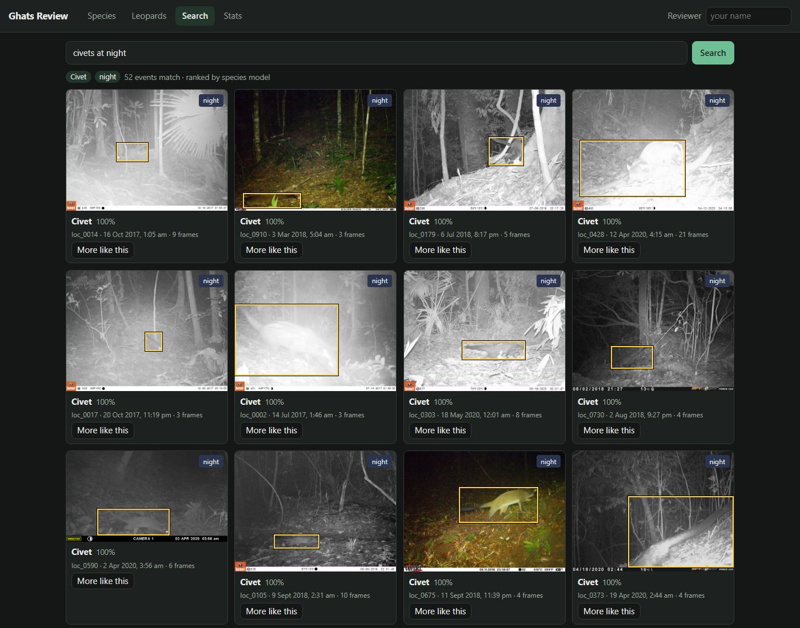
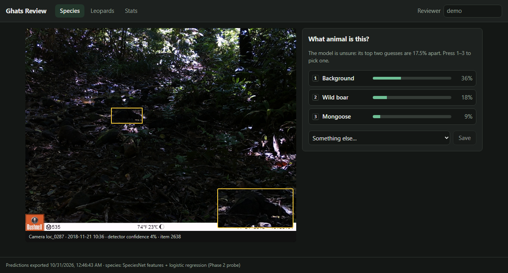
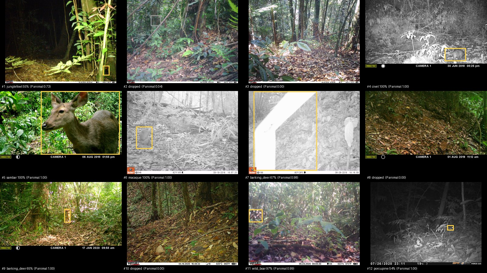

# Ghats Wildlife AI

Camera-trap image analysis for the Western Ghats: detect animals, filter empty
triggers, classify species groups, search an archive, and review predictions in a dashboard.
An ONNX pipeline processes photos, video and webcam input, with performance measured
on a laptop CPU.

The project uses public tropical Asian camera-trap images as a stand-in for local
conditions. It has not been evaluated on Western Ghats field data or deployed on
camera-trap hardware.

## Implemented features

| Component | Implementation |
|---|---|
| Detection | MegaDetector V6, event-level evaluation and empty-frame filtering |
| Species classification | ConvNeXt-Tiny and a frozen SpeciesNet backbone with a trained classification head; evaluation split by camera |
| Archive search | Species and metadata filters, BioCLIP 2 embeddings, and dashboard search |
| Human review | Species review queue, saved corrections, random audit sampling and review statistics |
| ONNX pipeline | Model export, quantisation experiments, photo/video/webcam processing, bandwidth estimates and laptop CPU benchmarks |

## Phase 1: detection and empty-frame filtering

**Question:** at what confidence threshold can MegaDetector remove most empty
frames while keeping (almost) every animal, on tropical Asian forest data it was
mostly not trained on?

**Data:** a balanced sample from [SWG Camera Traps 2018–2020](https://lila.science/datasets/swg-camera-traps)
(Vietnam and Laos, via LILA BC). It is the closest public stand-in for Western
Ghats conditions: dense forest, IR night images, and many of the same genera.
Species are mapped to Ghats groups in [`configs/phase1.yaml`](configs/phase1.yaml)
(e.g. red muntjac → barking deer, chevrotain → mouse deer).

### Run it

```bash
python -m venv .venv && source .venv/bin/activate      # Windows: .venv\Scripts\activate
pip install -r requirements.txt && pip install -e .

# 1. Metadata + ~1,200 sequences (~5,500 images, a few GB). Resumable.
python scripts/01_fetch_subset.py

# 2. Detector. Try --limit 50 first. CPU works; a GPU (or free Colab T4) is much faster.
python scripts/02_run_detector.py

# 3. Metrics, trade-off plot and summary
python scripts/03_evaluate.py

# 4. Picture grids of misses and false alarms (use the threshold from summary.md)
python scripts/04_gallery.py --threshold 0.01

# 5. Filter rules on top of the detector vs. the plain max score (uses saved detections)
python scripts/05_filter_experiments.py

pytest   # unit + end-to-end tests, no network or GPU needed
```

The metadata file is large, and parsing it needs a few GB of RAM. Fetching is a
one-time cost; everything after works offline.

### Results

5,726 frames in 1,200 trigger events (600 animal, 600 empty) from 507 camera
locations. Full numbers in [`reports/phase1/summary.md`](reports/phase1/summary.md).

| Threshold (per trigger event) | Animal events kept | Empty events removed | Review workload removed |
|---|---|---|---|
| 0.01 (the lowest stored) | 95.5% (27 of 600 missed) | 31.0% | 17.8% |
| 0.02 | 93.5% | 44.5% | 25.5% |
| 0.05 | 90.0% | 66.0% | 38.0% |

Worst species group at 0.01: pangolin 87.8%, then rodent 92.7% and macaque 92.9%.
Latency per image (GPU, RTX 3050 Laptop, batches of 16): 28 ms median, 40 ms p95,
including JPEG decode.


**The short version: out of the box, MegaDetector doesn't filter this forest well.**
The 98% recall target can't be reached at all. 27 animal events have no box above 0.01,
and keeping 95% of animals still leaves 69% of empty events for a person to review.
Things get better if you accept 90% recall, where it removes 66% of empty events.

**Why.** Looking at the highest-scoring "empty" events
([`false_alarms.jpg`](reports/phase1/false_alarms.jpg)) shows the same few culprits over
and over: big leaves right in front of the lens (scoring up to 0.88), dark rocks
and shadows, sun glare, and tree trunks cut off at the frame edge. Dense tropical
undergrowth is full of animal-sized, animal-shaped clutter.

Some of the errors are the labels, not the model. A couple of "empty" events contain
a person's legs or what looks like an animal at night. The missed animal events
([`missed_animals.jpg`](reports/phase1/missed_animals.jpg)) are a mix. At
thumbnail size most look empty, but the pangolin bursts I checked at full size do
have the animal in them: a dim shape the same colour as the leaf litter under IR.
Pangolin is the worst group (5 of the 27 misses).

### What I tried on top of the detector

If leaves cause the false alarms, two cheap rules should help, without any retraining.
Both are in [`src/ghats/filters.py`](src/ghats/filters.py) and compared in
[`reports/phase1/filter_experiments.md`](reports/phase1/filter_experiments.md).

| Rule (at the lowest threshold, 0.01) | Animal events kept | Empty events removed |
|---|---|---|
| Max score (baseline) | 95.5% | 31.0% |
| Burst agreement: 2 frames must see an animal | 91.8% | 40.2% |
| Burst agreement: the same box in 2 frames | 81.5% | 43.0% |
| Camera background: drop boxes where this camera fired in other events (IoU 0.5) | 93.8% | 32.5% |

Neither is better than just raising the threshold: at 0.03 the plain max score keeps
more animals (92.7%) and removes far more empty events (54%) than burst agreement's 40%. Burst agreement
fails for three reasons: 26% of events are a single frame, animals often show up in
only one frame of a burst, and leaves don't move, so they "agree" with themselves.
Camera background could work on a real deployment, but this sample deliberately
spreads across 507 cameras with a median of 2 events each, which isn't enough
history to learn what a camera's background looks like.

**What this means for Phase 2.** No rule on the detector's score will separate leaves
from animals here, because the scores overlap. The fix has to look at the crop itself.
Phase 2 trains a classifier on detector crops anyway, so it gets an extra
"vegetation / no animal" class trained on these exact false alarms.

### Design decisions

- **Sampling and evaluation by trigger event, not frame.** A camera fires a burst
  of frames per trigger, and LILA often labels the whole sequence. A frame where
  the animal has already left still says "wild pig", so frame-level misses are
  partly label noise. Event-level numbers are the honest headline.
- **Per-camera caps.** No camera contributes more than a few sequences, so the
  result reflects many backgrounds rather than one busy waterhole.
- **Thresholds are swept, not guessed.** The detector stores everything above
  0.01; the operating point is the highest threshold that keeps 98% of animal
  events, or the lowest threshold when even that falls short (as it does here).
- **Per-group recall.** Small and nocturnal animals are where detectors usually
  fail, so recall is reported per species group. Here the weakest was pangolin
  (87.8%), then rodent and macaque.
- **Boxes on the letterbox padding are dropped.** SWG frames are wider than they
  are tall, so the 640×640 input is padded above and below. The model puts low-
  confidence boxes (up to ~0.2) on that padding in almost every image; after
  mapping back they sit wholly outside the frame and clamp to zero-height lines
  on the border. I first missed this, and it quietly ruined the numbers: their
  confidence is noise (event AUC 0.53), but it gave every event, empty or not, a
  score of ~0.08. The old "98.8% recall at 0.06" came from that, not from real
  boxes. I found it while looking at Phase 2 misses (`scripts/10_miss_gallery.py`).
  The first fix only dropped boxes of exactly zero height. Strips that end a pixel
  or two inside the frame survived, and I only caught them when the reviewer
  dashboard drew a 1-pixel box along the top of a photo: 1,531 of 23,643 Phase 2
  crops. The detector now also drops boxes under 16 px thick that lie on the frame
  edge (every animal box that thin was one of these strips; a tiny animal in the
  open is kept). In Phase 1 this cost a point of recall at the lowest threshold
  (96.5% → 95.5%): in 6 more animal events a strip had been the only "box".
- **The detector runs in eval mode, in batches.** PyTorch-Wildlife 1.3's
  `single_image_detection()` for the MIT model reloads the checkpoint on every call
  and leaves the network in training mode, so BatchNorm normalises each image with
  its own statistics instead of the learned ones. `src/ghats/detector.py` loads the
  model once, calls `eval()`, and runs batches fed by a multi-process DataLoader.
  On the Phase 1 set this raised event-level AUC from 0.870 to 0.903 (both measured
  before the padding fix below; 0.910 after it) and cut
  latency from 826 ms to 28 ms per image (median).
- **MIT-licensed detector by default.** `MegaDetectorV6MIT` avoids the AGPL terms
  of the Ultralytics-based weights; the config can switch models for comparison.

## Phase 2: species classifier on detector crops

**Question:** can a classifier that looks at each detector crop name the species, and
also catch the leaves and rocks that fool the detector?

```bash
python scripts/06_make_crops.py          # detector boxes -> labelled crops, split by camera
python scripts/07_train_classifier.py    # ConvNeXt-Tiny, ~75 s/epoch on an RTX 3050 Laptop
python scripts/09_event_eval.py          # empty-event filtering: detector vs classifier
python scripts/10_miss_gallery.py --threshold 0.504   # animal events the filter throws away
python scripts/11_speciesnet_probe.py    # frozen SpeciesNet features + logistic regression head
```

**Crops and labels.** Every animal box at 0.02 or above becomes a crop (up to 5 per frame).
Boxes in empty events are labelled "background". Boxes in animal events take the event's
species group, but only boxes at 0.2 or above are used for training, since a weak box
next to an animal is often a leaf.

**Split by camera, not by image.** Whole camera locations go to train, val or test
(70/15/15). Frames from one camera share a background, so a random split would let the
model recognise the place instead of the animal. Test is 106 cameras the model never saw.

**Model.** ConvNeXt-Tiny (ImageNet-22k weights, via timm), 12 epochs, mixed precision,
square-root class weights for the imbalance, label smoothing 0.1, best epoch picked
on val macro F1.

### Results

**Crops** (test, 2,338 crops): macro F1 **0.775**, accuracy 0.830. Best: junglefowl 0.93,
wild boar 0.91, bear 0.90. Worst: squirrel 0.46 and mongoose 0.49, small classes with
20–50 test crops each. Background F1 is 0.84. Details in
[`classifier_summary.md`](reports/phase2/classifier_summary.md) (written before the
padding strips were removed, so it still counts 2,383 crops; the model was not retrained
without the 192 strips in its training background, and on the cleaned test set its scores
moved by 0.001-0.003).

**Empty-event filtering** (test, 566 events from unseen cameras; each threshold is picked
on val and applied unchanged to test):

| Keep 90% of animal events | Empty events removed |
|---|---|
| Detector confidence (Phase 1 rule) | 55.3% |
| Classifier: P(not background) of the best box | **70.7%** |
| Classifier × detector | 63.3% |

The classifier removes about 15 points more empty events at the same recall. Stricter
targets are out of reach for every method: 29 of 416 animal test events (7%) have no
detector box at all, so nothing downstream can recover them. (It was 25 before the
leftover padding strips were removed: in 4 events a strip was the only "box".) Full table, including
per-group recall, in [`event_eval.md`](reports/phase2/event_eval.md).

**Where it still fails** ([`missed_events.jpg`](reports/phase2/missed_events.jpg)).
At the 90% threshold, 83 val/test animal events are dropped. 59 of them never had a box
(a detector miss), and 24 had boxes the classifier called background. The detector is
the bigger bottleneck, and it is worst on small animals: rodents, squirrels and martens.

### Against off-the-shelf classifiers

`scripts/08_run_baselines.py` runs two existing camera-trap classifiers on the same
val/test boxes and maps their labels onto my groups:
[SpeciesNet](https://github.com/google/cameratrapai) v4.0.2a (Google, ~2,500 labels,
65M+ training images) and the Addax Data Science Central India model (IND-ADS, 40 labels,
CC-BY-NC, used for evaluation only).

| Model | Macro F1, 12 shared classes (2,094 test crops) | Empty events removed at 90% recall |
|---|---|---|
| Mine (ConvNeXt-Tiny, ~10k crops) | 0.810 | 70.7% |
| SpeciesNet | **0.902** | **80.7%** |
| IND-ADS (Central India) | 0.641 | 59.3% |

**SpeciesNet wins, with a caveat.** Its training data includes public camera-trap
repositories, and I couldn't confirm whether SWG was among them. If it was, it has seen
these exact cameras, and the comparison flatters it. Even so, the gap is largest exactly
where my model has the least data: mongoose 0.94 vs 0.51, sambar 0.99 vs 0.77. Mine is
ahead only on small cats (0.70 vs 0.63) and bears (0.90 vs 0.88). The Central India model
is the more honest out-of-domain test: trained on Indian forest, it is weaker than mine
on Vietnamese and Lao cameras (0.64), especially on macaques (0.36) and small cats (0.25).

### Building on SpeciesNet instead

Is SpeciesNet's edge its backbone (features learned from 65M camera-trap images) or its
head (which may have seen SWG)? `scripts/11_speciesnet_probe.py` keeps the backbone frozen,
takes its pooled 1,280-d features for every crop, and fits a logistic regression on my
train cameras only. This is the same recipe the Central India model uses, just trained
on my groups and cameras. It takes ~15 minutes on the 3050, mostly feature extraction.

| Model | Macro F1, all 16 classes (2,338 test crops) | Macro F1, 12 shared classes | Empty events removed at 90% recall |
|---|---|---|---|
| Mine (ConvNeXt-Tiny, trained end to end) | 0.775 | 0.810 | 70.7% |
| **SpeciesNet features + my head** | **0.886** | **0.920** | 74.0% |
| SpeciesNet off the shelf | n/a | 0.902 | **80.7%** |

The probe is the best species classifier here, ahead even of SpeciesNet's own head on
the shared classes. The biggest gains over my ConvNeXt are on the classes I had the least
data for: mongoose 0.49 → 0.91, squirrel 0.46 → 0.64, sambar 0.77 → 0.95. For filtering
empty events SpeciesNet is ahead (80.7% vs 74.0%), though the gap is about the size of the
±6 point noise of 150 empty test events. Details in
[`classifier_summary_probe.md`](reports/phase2/classifier_summary_probe.md).

The SWG caveat still applies: if SpeciesNet's backbone was trained on these cameras, the
probe benefits too. Only data from cameras SpeciesNet has never seen, ideally from the
Ghats, would settle that.

What I take from it: with ~10k labelled crops, a strong pretrained camera-trap backbone
plus a small head beats training a model end to end, and costs a fraction of the compute.
That's the setup I'd carry forward. The parts of the project I'd call my own are the
evaluation (event-level, unseen cameras, thresholds picked on val) and finding the
padding bug.

**Things I tried that didn't help** (on the earlier run, before the padding fix):
requiring a second convincing box per event (22% of animal events have only one),
temperature scaling (better calibrated probabilities, same ranking, so the same
filtering), and turning off label smoothing (slightly higher F1, filtering within noise:
150 empty test events give about ±6 points).

## Phase 4: search in plain English

**Question:** can someone type "civets at night" or "animal drinking water" and get the
right trigger events back, and which parts of that can a CLIP-style model do?



### Run it

```bash
pip install open_clip_torch
python scripts/29_embed.py              # every frame and crop -> a vector (~10 min on an RTX 3050, both models)
python scripts/30_search_eval.py        # queries with known answers, test cameras
python scripts/32_search_gallery.py     # queries judged by eye -> reports/phase4/gallery/
python scripts/31_search_server.py      # http://127.0.0.1:4318; the dashboard's Search tab talks to it
```

The models are loaded from local copies with safetensors weights only (the download line
is in `29_embed.py`'s docstring), so nothing is unpickled. The index is the val and test
cameras of Phase 2: 1,115 events, 5,635 frames, 7,143 detector crops. The Phase 2 species
model was trained on the train cameras, so its predictions are only honest on the others.

### How a query is read

[`src/ghats/search.py`](src/ghats/search.py) splits a query into two parts:

- **Filters**, for whatever the metadata already answers exactly: species (word lists in
  [`configs/phase4.yaml`](configs/phase4.yaml), including the Ghats names for the SWG
  stand-ins, so "sloth bear" or "Nilgiri marten" work), night or day (capture hour), empty,
  "two or more", camera, year, month. Species comes from the Phase 2 model: an event counts
  when one of its boxes gets >= 0.8 for that species.
- **Meaning**, for the words left over ("drinking water", "climbing"): the query is turned
  into a BioCLIP 2 text vector and compared with the image vector of every frame and crop.
  An event scores as well as its best frame or crop.

If nothing is left over ("sambar at night"), the filtered events are ranked by the species
model's probability. The dashboard shows how the query was read (the chips under the
search box), so a wrong reading is easy to spot.

### Results

On the 566 test-camera events (settings picked on the 549 val events; full tables in
[`reports/phase4/search_eval.md`](reports/phase4/search_eval.md)). AP is average precision:
1.0 means every right event ranks above every wrong one.

| Query type | Phase 2 model / metadata | BioCLIP 2 | OpenAI CLIP | Random order |
|---|---|---|---|---|
| Species (15 queries, mean AP) | **0.872** | 0.540 | 0.362 | 0.049 |
| Empty events | **0.701** | 0.333 | 0.308 | 0.265 |
| Night (truth = capture hour) | colour score 0.653 | 0.738 | **0.888** | 0.417 |

- **The trained species model wins easily.** Added to it with a weight chosen on val,
  BioCLIP's score adds nothing: the weight comes out at 0. BioCLIP 2 without any training is
  far better than chance and better than CLIP, but squirrels (0.04) and rodents (0.19) are
  almost invisible to it. Those are small animals in a 224-pixel image.
- **Scientific names work better than common names** for BioCLIP 2 (0.54 vs 0.43), which
  makes sense for a model trained on taxonomic labels. Crops work better than whole frames
  (0.54 vs 0.36).
- **"Empty" is not a concept these models have.** Embedding search for empty frames is
  barely above random order. The detector-based filter is the only thing that works.
- **Night is the exception.** CLIP picks out night shots well, better than my colour score
  ("IR shots are grey"), which some flash cameras break. Search uses the capture hour, which
  is the ground truth here by definition. An embedding would only help when a camera's clock is wrong.
- **The species filter** keeps 79% of the right test events, and 96% of what it keeps is right.

For questions the labels can't check, I looked at the top 12 for 11 queries
([`reports/phase4/by_eye.md`](reports/phase4/by_eye.md), sheets in `reports/phase4/gallery/`):

| Query | Right in the top 12 |
|---|---|
| sambar at night | 12 |
| bird on the ground | 12 junglefowl events |
| two wild pigs | 12 pigs, 5 with two or more in view |
| macaque climbing a tree | 12 macaques, 1 climbing |
| animal drinking water | 0 drinking, though 6 are at a stream |
| mother with young | 0 |

So filters do the precise work, and the embeddings understand scenes (water, haze, a dark
frame) but not what an animal is doing. A text-only query always returns something: "a
tiger" brings back small cats and empty frames, because there are no tigers in this data.

**A bug the contact sheets caught:** at first the boxes shown were often on leaves next to
the animal. The crops go down to detector confidence 0.02, and a patch of leaves can match
"a bird" better than the bird in the next box. Now only crops >= 0.1 are compared with the
text. On the labelled species queries any floor from 0 to 0.3 scores within 0.02 AP, so the
choice rests on the sheets, not the numbers.

### In the dashboard

The Search tab sends the query to the review API, which forwards it to
`31_search_server.py`, so the browser only talks to one server. The search server holds BioCLIP 2's text
encoder on the CPU (about 260 ms per query with leftover words, about 20 ms for filters
only). Each result shows the frame and box that matched, the species model's guess, camera
and time, and a **More like this** button that searches with that event's best crop.
`?tab=search&q=...` opens a search directly, so a search can be shared as a link.

### Search limitations

Behaviour queries such as "drinking" and "climbing" were unreliable in the manual
review. Text-only queries always return a ranking, even when no relevant animal is
present. Counts are based on detector boxes and can count one animal twice.
The index is stored in numpy arrays.

## Phase 5: reviewer dashboard

The dashboard helps a person check species predictions and records their decisions
in SQLite. It uses a Python prediction export, an Express + TypeScript API, and a
React + TypeScript UI.



The species queue presents crops with the smallest gap between the top two predictions
first. Reviewers can inspect the full frame, detection box, close-up and nearby burst
frames, then choose a species or mark the item unsure. Keyboard shortcuts support
quick review. A random audit sample is mixed into the queue so statistics do not rely
only on the hardest examples.

```bash
python scripts/22_export_review.py   # requires existing model outputs and configured assets
cd dashboard
npm install
npm run dev:api                      # http://127.0.0.1:4317
npm run dev:web                      # http://localhost:5317, in a second terminal
npm test                             # API tests
```

The Search tab also requires `scripts/31_search_server.py` to be running.
Reviews are saved separately from model predictions. Corrections do not automatically
retrain the species model; this is a review workflow rather than an automated
active-learning loop.

## Phase 6: ONNX pipeline and laptop benchmarks

The pipeline runs detection and species classification locally and writes a crop
and metadata for each kept event. Measurements below use a Ryzen 5 5600H laptop
CPU, limited to four threads. They are not Raspberry Pi or Jetson measurements.
The core camera code uses numpy, Pillow and ONNX Runtime.

### Run it

```bash
pip install -e ".[edge]"
python scripts/23_export_onnx.py        # PyTorch -> ONNX, checked against PyTorch outputs
python scripts/24_quantize.py           # INT8 experiments; detector and species trade-offs below
python scripts/26_live.py --source path/to/photos/     # or clip.mp4, or 0 for a webcam (--show for a window)
python scripts/27_bandwidth.py          # data sent, Phase 2 test set
python scripts/28_benchmark.py          # speed and memory per model
python scripts/25_edge_eval.py --models detector species --variants fp32 int8   # accuracy, ~2 h on 4 threads
```

`requirements-pi.txt` lists the minimal runtime dependencies. The pipeline needs
exported detector and species ONNX models plus the trained species head (`head.npz`).
A test checks that the camera code imports without pandas, torch, scikit-learn or OpenCV.

### The camera pipeline

`scripts/26_live.py` (logic in [`src/ghats/live.py`](src/ghats/live.py)) takes a folder of
photos, a video file or a webcam:

1. **Detector** (MegaDetector, FP32 ONNX by default; INT8 optional) finds animal boxes;
   letterbox, NMS and box clean-up are a numpy copy of PyTorch-Wildlife's.
2. **Species model** (SpeciesNet backbone, FP32 ONNX) runs only on frames with a box, and
   the Phase 2 probe head turns its features into a group and P(not background). The head
   is 16 rows of weights, applied in numpy.
3. **Events.** Photos are grouped into triggers by time gap (EXIF time, else file time).
   Video is sampled at 2 fps and an event is a run of frames with an animal, closed after
   3 s without one, so a sambar walking past is one sighting, not 50.
4. **Keep or drop.** An event is kept when its best box has P(not background) >= 0.273,
   the Phase 2 operating point picked on val cameras. The species is a vote over the
   event's boxes, weighted by how animal-like each is, so one blurry frame doesn't decide it.
5. **Send** one padded crop of the best box (longest side 384 px) and a JSON line:
   species, time, P(animal), box.

On 12 test-camera triggers (6 animal, 6 empty; cameras no model trained on), all six
animals were kept with the right species (civet, sambar, macaque, two barking deer, wild
boar, porcupine) and 4 of the 6 empty triggers were dropped. The camera would have sent
252 KB instead of 76 MB of photos.



The two false alarms are worth a look: #7 is a branch blown out to a white bar by the IR
flash (P(animal) 0.98, "barking deer"), and #1 is a small box on undergrowth at night. A
test clip built from the same frames (empty, sambar, empty, macaque) came out as the right
two sightings at the right times, plus the same blown-out branch.

### What a camera would send

[`reports/phase6/bandwidth.md`](reports/phase6/bandwidth.md): the 566 Phase 2 test
triggers (2,886 photos, 1.5 MB each) from 114 unseen cameras, thresholds from val.

| Policy | Animal events kept | Empty events sent | Data sent | Share |
|---|---|---|---|---|
| Every photo | 100% | 100% | 4,442 MB | 100% |
| Photos of events the detector keeps | 91.1% | 44.7% | 3,838 MB | 86% |
| Photos of events the detector + species model keep | 91.3% | 26.0% | 3,649 MB | 82% |
| **One crop + metadata per kept event** | 91.3% | 26.0% | **10.8 MB** | **0.24%** |

Filtering alone saves little here, because this test set is 74% animal triggers by design.
Sending crops instead of photos is the big win: about 28 KB per animal event instead of
10 MB. Projected to a camera where 80% of triggers are empty (common with wind and sun),
1,000 triggers cost ~6,200 MB as photos, ~2,700 MB as filtered photos and ~8 MB as crops,
small enough for a cellular or satellite link.

### Quantisation: what INT8 cost

INT8 stores weights and activations as 8-bit integers: ~4x smaller, and the integer maths
small ARM CPUs and NPUs are fast at. Accuracy is checked on the same test sets and metrics
as the earlier phases ([`reports/phase6/`](reports/phase6/)).

| Model (test set) | Metric | PyTorch (GPU) | ONNX FP32 | ONNX INT8 | Size FP32 -> INT8 |
|---|---|---|---|---|---|
| Detector (Phase 1, 1,200 events) | event AUC | 0.910 | 0.910 | 0.900 | 27.7 -> 12.2 MB |
| | empties removed at 90% recall | 66.2% | 66.2% | **58.5%** | |
| | recall at the FP32 threshold, unchanged | 90.0% | 89.8% | 89.0% | |
| Species (Phase 2, 2,338 crops) | macro F1 | 0.887 | 0.887 | **0.039** | 201 -> 55 MB |

The FP32 exports match PyTorch (the detector's event scores move by at most 0.013 with the
numpy post-processing). INT8 is
a mixed result:

- **Detector**: INT8 costs 8 points of filtering at the same recall (58.5% vs 66.2% of
  empty events removed), and 22% of events see their score move by more than 0.05, so a
  threshold tuned on FP32 doesn't carry over cleanly. On this x86 laptop it is also slower
  (278 vs 187 ms per frame on 4 threads, see Speed), so its only win here is size. The camera
  config therefore defaults to the **FP32 detector**; ARM CPUs with dot-product
  instructions, like the Pi 5's, may run INT8 faster, which only a benchmark on the device
  can settle.

**The species model doesn't survive INT8.** On the 2,338 Phase 2 test crops the FP32 ONNX
model matches PyTorch exactly (macro F1 0.887, accuracy 92.3%), and the INT8 one falls to
macro F1 0.039 and 19% accuracy. It agrees with the FP32 prediction on 21% of crops, and
its features point in an unrelated direction (cosine down to -0.51). I measured the error
layer by layer: each layer on its own keeps 22-34 dB SQNR, which is normal for INT8, but nothing in
EfficientNetV2 resets the error, so it compounds to about 7 dB by block 2 of 7. Keeping the
squeeze-excite and depthwise convolutions in float (132 of 245) didn't help, and dynamic
INT8 was as wrong and 15x slower. The fix would be quantisation-aware training, which needs
SpeciesNet's training data. So the camera runs the species model in FP32, which costs
less than it sounds: it only runs on frames where the detector found something.

The detector needed three fixes to quantise well, all found by comparing layer outputs:
signed 8-bit activations (ONNX Runtime's unsigned default overflows on x86 CPUs without
VNNI, like this laptop's Ryzen), detection heads kept in float (their class-score
convolutions quantised worst, 14-17 dB), and percentile calibration on train-camera frames.

### Speed

[`reports/phase6/benchmark_laptop-ryzen5-5600h.md`](reports/phase6/benchmark_laptop-ryzen5-5600h.md),
`scripts/28_benchmark.py`: batch 1, ONNX Runtime CPU, Ryzen 5 5600H laptop (x86, no VNNI).

| Model | MB | 1 thread | 2 threads | 4 threads | Memory |
|---|---|---|---|---|---|
| Detector FP32 | 27.7 | 539 ms | 291 ms | **187 ms** | 106 MB |
| Detector INT8 | 12.2 | 717 ms | 406 ms | 278 ms | 133 MB |
| Species FP32 (per box) | 201 | 1,010 ms | 521 ms | 298 ms | 265 MB |

On four threads, the detector model takes about 0.2 seconds per frame, and the
species model adds about 0.3 seconds per box. These measurements describe the laptop
only; device speed, power consumption and field reliability have not been measured.
The default detector and species models stay in FP32 because INT8 reduced accuracy
and made the detector slower on this CPU.

## Repository layout

```text
configs/                  sampling, model, search, review and runtime settings
src/ghats/                detection, classification, evaluation, search and runtime code
scripts/01..05            fetch, detect, evaluate and inspect filtering errors
scripts/06..11            crops, classifier training, baselines and species evaluation
scripts/22_export_review.py  export predictions for the dashboard
scripts/23..28            ONNX export, quantisation, evaluation, runtime and benchmarks
scripts/29..32            embeddings, search evaluation, server and visual inspection
dashboard/server/         Express + TypeScript review API backed by SQLite
dashboard/web/            React + TypeScript dashboard
requirements-pi.txt       minimal camera runtime dependencies
tests/                    unit and synthetic pipeline tests
reports/                  evaluation reports, plots and screenshots
```

## Data and models

- SWG Camera Traps 2018–2020, CDLA-Permissive-1.0. Citation: SWG (2021),
  *Northern and Central Annamites Camera Traps 2.0*, IUCN SSC Asian Wild Cattle
  Specialist Group's Saola Working Group.
- MegaDetector V6 via [PyTorch-Wildlife](https://github.com/microsoft/CameraTraps).
- ConvNeXt-Tiny via timm; SpeciesNet (Google) weights from Addax Data Science.
- BioCLIP 2 (Imageomics, MIT) and OpenAI CLIP ViT-B/16 (timm copy, Apache-2.0) via open_clip.
