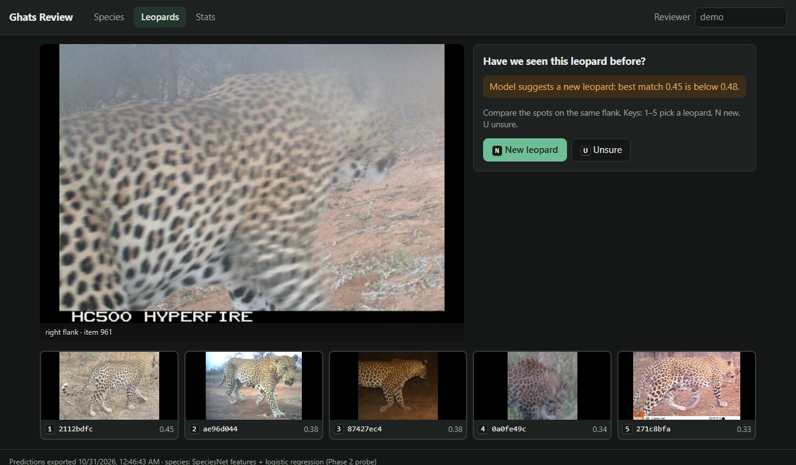
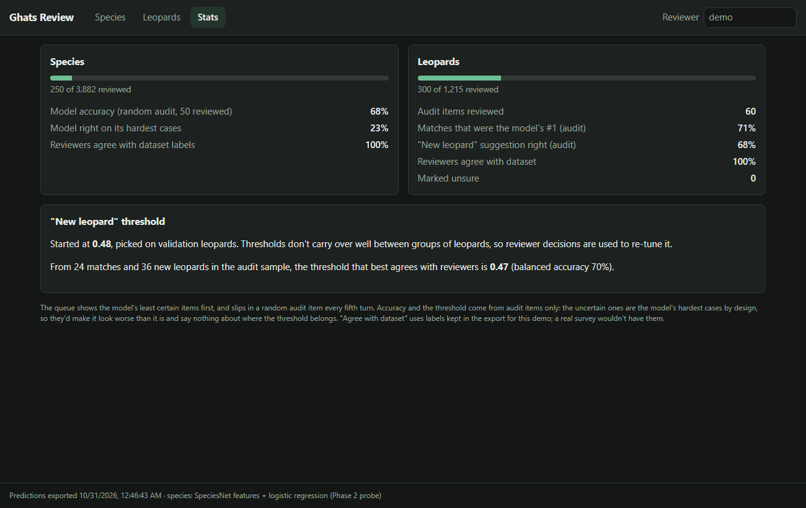

# Ghats Wildlife AI

Camera-trap intelligence for the Western Ghats: find the animals in thousands of
trigger images, identify the species, recognise individual leopards, search the
archive in plain English, and run it all on a low-power device in the forest.

Forest departments and researchers in Goa (Mhadei, Bhagwan Mahavir, Cotigao,
Netravali) collect far more camera-trap images than anyone can review by hand,
and most frames are empty, triggered by wind, sun or moving leaves. This project
builds the pipeline that does the first pass automatically and sends people only
what needs a human decision.

## Roadmap

| Phase | What | Status |
|---|---|---|
| 1 | Animal detection and empty-frame filtering (MegaDetector V6) | **Done** (results below) |
| 2 | Species classification for Ghats groups, location-split evaluation, SpeciesNet baseline | **Done** (results below) |
| 3 | Leopard re-identification (metric learning + travel-feasibility prior) | **Done**; travel prior tested on a second dataset (LeopardID102) |
| 4 | Search the photos in plain English (filters + BioCLIP 2 embeddings), in the dashboard | **Done** (results below) |
| 5 | Reviewer dashboard with an active-learning loop | **Done**: review + audit sample + threshold re-tuning; retraining from reviews not yet |
| 6 | Edge deployment: ONNX/INT8 camera pipeline (photos, video, webcam), cascade design, bandwidth, benchmarks | **Done** on a laptop CPU standing in for a Pi; no Pi/Jetson numbers yet |

## Phase 1: detection and empty-frame filtering

**Question:** at what confidence threshold can MegaDetector remove most empty
frames while keeping (almost) every animal, on tropical Asian forest data it was
mostly not trained on?

**Data:** a balanced sample from [SWG Camera Traps 2018–2020](https://lila.science/datasets/swg-camera-traps)
(Vietnam and Laos, via LILA BC). It is the closest public stand-in for Western
Ghats conditions: dense forest, IR night images, and many of the same genera.
Species are mapped to Ghats groups in [`configs/phase1.yaml`](configs/phase1.yaml)
(e.g. red muntjac → barking deer, chevrotain → mouse deer).

### Run it

```bash
python -m venv .venv && source .venv/bin/activate      # Windows: .venv\Scripts\activate
pip install -r requirements.txt && pip install -e .

# 1. Metadata + ~1,200 sequences (~5,500 images, a few GB). Resumable.
python scripts/01_fetch_subset.py

# 2. Detector. Try --limit 50 first. CPU works; a GPU (or free Colab T4) is much faster.
python scripts/02_run_detector.py

# 3. Metrics, trade-off plot and summary
python scripts/03_evaluate.py

# 4. Picture grids of misses and false alarms (use the threshold from summary.md)
python scripts/04_gallery.py --threshold 0.01

# 5. Filter rules on top of the detector vs. the plain max score (uses saved detections)
python scripts/05_filter_experiments.py

pytest   # unit + end-to-end tests, no network or GPU needed
```

The metadata file is large, and parsing it needs a few GB of RAM. Fetching is a
one-time cost; everything after works offline.

### Results

5,726 frames in 1,200 trigger events (600 animal, 600 empty) from 507 camera
locations. Full numbers in [`reports/phase1/summary.md`](reports/phase1/summary.md).

| Threshold (per trigger event) | Animal events kept | Empty events removed | Review workload removed |
|---|---|---|---|
| 0.01 (the lowest stored) | 95.5% (27 of 600 missed) | 31.0% | 17.8% |
| 0.02 | 93.5% | 44.5% | 25.5% |
| 0.05 | 90.0% | 66.0% | 38.0% |

Worst species group at 0.01: pangolin 87.8%, then rodent 92.7% and macaque 92.9%.
Latency per image (GPU, RTX 3050 Laptop, batches of 16): 28 ms median, 40 ms p95,
including JPEG decode.


**The short version: out of the box, MegaDetector doesn't filter this forest well.**
The 98% recall target can't be reached at all. 27 animal events have no box above 0.01,
and keeping 95% of animals still leaves 69% of empty events for a person to review.
Things get better if you accept 90% recall, where it removes 66% of empty events.

**Why.** Looking at the highest-scoring "empty" events
([`false_alarms.jpg`](reports/phase1/false_alarms.jpg)) shows the same few culprits over
and over: big leaves right in front of the lens (scoring up to 0.88), dark rocks
and shadows, sun glare, and tree trunks cut off at the frame edge. Dense tropical
undergrowth is full of animal-sized, animal-shaped clutter.

Some of the errors are the labels, not the model. A couple of "empty" events contain
a person's legs or what looks like an animal at night. The missed animal events
([`missed_animals.jpg`](reports/phase1/missed_animals.jpg)) are a mix. At
thumbnail size most look empty, but the pangolin bursts I checked at full size do
have the animal in them: a dim shape the same colour as the leaf litter under IR.
Pangolin is the worst group (5 of the 27 misses).

### What I tried on top of the detector

If leaves cause the false alarms, two cheap rules should help, without any retraining.
Both are in [`src/ghats/filters.py`](src/ghats/filters.py) and compared in
[`reports/phase1/filter_experiments.md`](reports/phase1/filter_experiments.md).

| Rule (at the lowest threshold, 0.01) | Animal events kept | Empty events removed |
|---|---|---|
| Max score (baseline) | 95.5% | 31.0% |
| Burst agreement: 2 frames must see an animal | 91.8% | 40.2% |
| Burst agreement: the same box in 2 frames | 81.5% | 43.0% |
| Camera background: drop boxes where this camera fired in other events (IoU 0.5) | 93.8% | 32.5% |

Neither is better than just raising the threshold: at 0.03 the plain max score keeps
more animals (92.7%) and removes far more empty events (54%) than burst agreement's 40%. Burst agreement
fails for three reasons: 26% of events are a single frame, animals often show up in
only one frame of a burst, and leaves don't move, so they "agree" with themselves.
Camera background could work on a real deployment, but this sample deliberately
spreads across 507 cameras with a median of 2 events each, which isn't enough
history to learn what a camera's background looks like.

**What this means for Phase 2.** No rule on the detector's score will separate leaves
from animals here, because the scores overlap. The fix has to look at the crop itself.
Phase 2 trains a classifier on detector crops anyway, so it gets an extra
"vegetation / no animal" class trained on these exact false alarms.

### Design decisions

- **Sampling and evaluation by trigger event, not frame.** A camera fires a burst
  of frames per trigger, and LILA often labels the whole sequence. A frame where
  the animal has already left still says "wild pig", so frame-level misses are
  partly label noise. Event-level numbers are the honest headline.
- **Per-camera caps.** No camera contributes more than a few sequences, so the
  result reflects many backgrounds rather than one busy waterhole.
- **Thresholds are swept, not guessed.** The detector stores everything above
  0.01; the operating point is the highest threshold that keeps 98% of animal
  events, or the lowest threshold when even that falls short (as it does here).
- **Per-group recall.** Small and nocturnal animals are where detectors usually
  fail, so recall is reported per species group. Here the weakest was pangolin
  (87.8%), then rodent and macaque.
- **Boxes on the letterbox padding are dropped.** SWG frames are wider than they
  are tall, so the 640×640 input is padded above and below. The model puts low-
  confidence boxes (up to ~0.2) on that padding in almost every image; after
  mapping back they sit wholly outside the frame and clamp to zero-height lines
  on the border. I first missed this, and it quietly ruined the numbers: their
  confidence is noise (event AUC 0.53), but it gave every event, empty or not, a
  score of ~0.08. The old "98.8% recall at 0.06" came from that, not from real
  boxes. I found it while looking at Phase 2 misses (`scripts/10_miss_gallery.py`).
  The first fix only dropped boxes of exactly zero height. Strips that end a pixel
  or two inside the frame survived, and I only caught them when the reviewer
  dashboard drew a 1-pixel box along the top of a photo: 1,531 of 23,643 Phase 2
  crops. The detector now also drops boxes under 16 px thick that lie on the frame
  edge (every animal box that thin was one of these strips; a tiny animal in the
  open is kept). In Phase 1 this cost a point of recall at the lowest threshold
  (96.5% → 95.5%): in 6 more animal events a strip had been the only "box".
- **The detector runs in eval mode, in batches.** PyTorch-Wildlife 1.3's
  `single_image_detection()` for the MIT model reloads the checkpoint on every call
  and leaves the network in training mode, so BatchNorm normalises each image with
  its own statistics instead of the learned ones. `src/ghats/detector.py` loads the
  model once, calls `eval()`, and runs batches fed by a multi-process DataLoader.
  On the Phase 1 set this raised event-level AUC from 0.870 to 0.903 (both measured
  before the padding fix below; 0.910 after it) and cut
  latency from 826 ms to 28 ms per image (median).
- **MIT-licensed detector by default.** `MegaDetectorV6MIT` avoids the AGPL terms
  of the Ultralytics-based weights; the config can switch models for comparison.

## Phase 2: species classifier on detector crops

**Question:** can a classifier that looks at each detector crop name the species, and
also catch the leaves and rocks that fool the detector?

```bash
python scripts/06_make_crops.py          # detector boxes -> labelled crops, split by camera
python scripts/07_train_classifier.py    # ConvNeXt-Tiny, ~75 s/epoch on an RTX 3050 Laptop
python scripts/09_event_eval.py          # empty-event filtering: detector vs classifier
python scripts/10_miss_gallery.py --threshold 0.504   # animal events the filter throws away
python scripts/11_speciesnet_probe.py    # frozen SpeciesNet features + logistic regression head
```

**Crops and labels.** Every animal box at 0.02 or above becomes a crop (up to 5 per frame).
Boxes in empty events are labelled "background". Boxes in animal events take the event's
species group, but only boxes at 0.2 or above are used for training, since a weak box
next to an animal is often a leaf.

**Split by camera, not by image.** Whole camera locations go to train, val or test
(70/15/15). Frames from one camera share a background, so a random split would let the
model recognise the place instead of the animal. Test is 106 cameras the model never saw.

**Model.** ConvNeXt-Tiny (ImageNet-22k weights, via timm), 12 epochs, mixed precision,
square-root class weights for the imbalance, label smoothing 0.1, best epoch picked
on val macro F1.

### Results

**Crops** (test, 2,338 crops): macro F1 **0.775**, accuracy 0.830. Best: junglefowl 0.93,
wild boar 0.91, bear 0.90. Worst: squirrel 0.46 and mongoose 0.49, small classes with
20–50 test crops each. Background F1 is 0.84. Details in
[`classifier_summary.md`](reports/phase2/classifier_summary.md) (written before the
padding strips were removed, so it still counts 2,383 crops; the model was not retrained
without the 192 strips in its training background, and on the cleaned test set its scores
moved by 0.001-0.003).

**Empty-event filtering** (test, 566 events from unseen cameras; each threshold is picked
on val and applied unchanged to test):

| Keep 90% of animal events | Empty events removed |
|---|---|
| Detector confidence (Phase 1 rule) | 55.3% |
| Classifier: P(not background) of the best box | **70.7%** |
| Classifier × detector | 63.3% |

The classifier removes about 15 points more empty events at the same recall. Stricter
targets are out of reach for every method: 29 of 416 animal test events (7%) have no
detector box at all, so nothing downstream can recover them. (It was 25 before the
leftover padding strips were removed: in 4 events a strip was the only "box".) Full table, including
per-group recall, in [`event_eval.md`](reports/phase2/event_eval.md).

**Where it still fails** ([`missed_events.jpg`](reports/phase2/missed_events.jpg)).
At the 90% threshold, 83 val/test animal events are dropped. 59 of them never had a box
(a detector miss), and 24 had boxes the classifier called background. The detector is
the bigger bottleneck, and it is worst on small animals: rodents, squirrels and martens.

### Against off-the-shelf classifiers

`scripts/08_run_baselines.py` runs two existing camera-trap classifiers on the same
val/test boxes and maps their labels onto my groups:
[SpeciesNet](https://github.com/google/cameratrapai) v4.0.2a (Google, ~2,500 labels,
65M+ training images) and the Addax Data Science Central India model (IND-ADS, 40 labels,
CC-BY-NC, used for evaluation only).

| Model | Macro F1, 12 shared classes (2,094 test crops) | Empty events removed at 90% recall |
|---|---|---|
| Mine (ConvNeXt-Tiny, ~10k crops) | 0.810 | 70.7% |
| SpeciesNet | **0.902** | **80.7%** |
| IND-ADS (Central India) | 0.641 | 59.3% |

**SpeciesNet wins, with a caveat.** Its training data includes public camera-trap
repositories, and I couldn't confirm whether SWG was among them. If it was, it has seen
these exact cameras, and the comparison flatters it. Even so, the gap is largest exactly
where my model has the least data: mongoose 0.94 vs 0.51, sambar 0.99 vs 0.77. Mine is
ahead only on small cats (0.70 vs 0.63) and bears (0.90 vs 0.88). The Central India model
is the more honest out-of-domain test: trained on Indian forest, it is weaker than mine
on Vietnamese and Lao cameras (0.64), especially on macaques (0.36) and small cats (0.25).

### Building on SpeciesNet instead

Is SpeciesNet's edge its backbone (features learned from 65M camera-trap images) or its
head (which may have seen SWG)? `scripts/11_speciesnet_probe.py` keeps the backbone frozen,
takes its pooled 1,280-d features for every crop, and fits a logistic regression on my
train cameras only. This is the same recipe the Central India model uses, just trained
on my groups and cameras. It takes ~15 minutes on the 3050, mostly feature extraction.

| Model | Macro F1, all 16 classes (2,338 test crops) | Macro F1, 12 shared classes | Empty events removed at 90% recall |
|---|---|---|---|
| Mine (ConvNeXt-Tiny, trained end to end) | 0.775 | 0.810 | 70.7% |
| **SpeciesNet features + my head** | **0.886** | **0.920** | 74.0% |
| SpeciesNet off the shelf | n/a | 0.902 | **80.7%** |

The probe is the best species classifier here, ahead even of SpeciesNet's own head on
the shared classes. The biggest gains over my ConvNeXt are on the classes I had the least
data for: mongoose 0.49 → 0.91, squirrel 0.46 → 0.64, sambar 0.77 → 0.95. For filtering
empty events SpeciesNet is ahead (80.7% vs 74.0%), though the gap is about the size of the
±6 point noise of 150 empty test events. Details in
[`classifier_summary_probe.md`](reports/phase2/classifier_summary_probe.md).

The SWG caveat still applies: if SpeciesNet's backbone was trained on these cameras, the
probe benefits too. Only data from cameras SpeciesNet has never seen, ideally from the
Ghats, would settle that.

What I take from it: with ~10k labelled crops, a strong pretrained camera-trap backbone
plus a small head beats training a model end to end, and costs a fraction of the compute.
That's the setup I'd carry forward. The parts of the project I'd call my own are the
evaluation (event-level, unseen cameras, thresholds picked on val) and finding the
padding bug.

**Things I tried that didn't help** (on the earlier run, before the padding fix):
requiring a second convincing box per event (22% of animal events have only one),
temperature scaling (better calibrated probabilities, same ranking, so the same
filtering), and turning off label smoothing (slightly higher F1, filtering within noise:
150 empty test events give about ±6 points).

## Phase 3: leopard re-identification

**Question:** given a photo of a leopard, can the system find other photos of the same
individual from its spot pattern? That is how survey teams count leopards and track
them across cameras.

**Data:** [Leopard ID 2022](https://lila.science/datasets/leopard-id-2022/) (Wild Me and
Botswana Predator Conservation Trust, via LILA BC): 6,795 photos of 430 named African
leopards, with boxes and a viewpoint label per animal. They're not Indian leopards, but
it's the same species and the same spot-matching problem. I keep only left and right flank
views (4,502 crops), because front and back views show different spots.

```bash
python scripts/12_leopard_crops.py   # crops + split by individual (needs the 8 GB download, see configs/phase3.yaml)
python scripts/13_reid_baseline.py   # off-the-shelf embeddings, retrieval metrics
```

**How it's evaluated** ([`src/ghats/reid.py`](src/ghats/reid.py)):

- **Split by individual.** Test leopards (107 of them, 1,361 crops) are never used for
  training or tuning. Same idea as splitting by camera in Phase 2.
- **No same-encounter matches.** Photos from one sighting are near-duplicates, so matching
  them says nothing about recognising the leopard weeks later; they're removed from the
  ranking. The dataset has no timestamps, so an encounter is a run of consecutive image ids
  showing the same leopard. That's a proxy, so I also report how many correct matches come
  from images within 10 ids of the query (16% here).
- **Same flank only.** A left-side photo can only be matched by another left-side photo.
- **Averaged per leopard.** A few leopards were photographed 100+ times. Averaged per query,
  they dominate: SpeciesNet's top-1 is 62.5% per query but 36.7% per leopard. Like macro F1
  in Phase 2, the per-leopard number is the headline.

### Baseline: off-the-shelf features, no training

Every crop is embedded, then each test crop is a query against all the other test crops.

| Model | Top-1 | Top-5 | mAP | Val top-1 |
|---|---|---|---|---|
| DINOv2 ViT-B/14 (general-purpose) | 26.7% | 37.3% | 22.2% | 30.0% |
| DINOv2 ViT-S/14 | 29.6% | 38.4% | 22.7% | 28.9% |
| SpeciesNet backbone (camera-trap species classifier) | 36.7% | 47.0% | 25.9% | 27.9% |

None of these models was trained to tell individuals apart, and it shows: the right leopard
comes first about a third of the time. SpeciesNet leads on test but not on val, so with ~100
leopards per split there is no clear winner yet. Full numbers in
[`reid_baseline.md`](reports/phase3/reid_baseline.md).

### Fine-tuned with ArcFace

```bash
python scripts/14_train_reid.py      # DINOv2-S + ArcFace on the train leopards, ~65 s/epoch on an RTX 3050
```

ArcFace trains the embedding so photos of one leopard sit close together and other
leopards are pushed a fixed angle away. Choices that matter here:

- **A class is one leopard's flank**, not one leopard (355 flanks from 209 leopards).
  The left and right sides have different spots, so they shouldn't be pulled together.
- **No horizontal flips.** The usual augmentation would turn a left flank into a right
  flank that doesn't exist. Instead: random crops, colour jitter, and random grayscale,
  since night photos are infrared.
- **DINOv2-S, fully fine-tuned**, input 224×448 (flank crops are wide), 20 epochs, the
  best epoch picked on val leopards.

| Test, 107 unseen leopards | Top-1 | Top-5 | Top-10 | mAP |
|---|---|---|---|---|
| DINOv2-S, untrained (same input size) | 28.4% | 39.7% | 44.3% | 22.8% |
| SpeciesNet backbone, untrained (best baseline) | 36.7% | 47.0% | 50.4% | 25.9% |
| **DINOv2-S + ArcFace** | **40.2%** | **57.1%** | **64.5%** | **35.4%** |

Fine-tuning lifts every metric. The clearest gain is in the shortlist: the right leopard is
in the top 5 for 57% of leopards, up from 40%. Top-1 beats the best baseline by only 3.5
points, which is within the noise of ~100 test leopards (about ±5 points); top-5 and mAP
gain 10 points each, which is not. The training loss reached almost zero by epoch 10 while
val top-1 stayed at 35–39%, so with 2,450 training photos the model memorises the training
leopards faster than it learns general spot matching. More leopards would help more than
more epochs. Details in [`reid_finetune.md`](reports/phase3/reid_finetune.md). (Tested
below: adding 101 leopards from another dataset lifts top-1 by about 10 points.)

In practice that makes this a ranking tool, not an automatic identifier: show a reviewer
the top 5 or 10 candidates and let them confirm, which is the Phase 5 dashboard.

### Recognising new leopards (open set)

```bash
python scripts/15_open_set.py        # "new individual" threshold, simulated on unseen leopards
```

Plain retrieval always returns the closest leopard, even for an animal that's not in the
catalogue. Real surveys meet new leopards all the time, so the system needs to be able to
answer "new": if the best match is less similar than a threshold, call it new.

To test that, I hide a random half of the test leopards from the gallery, so their photos
should come back "new", and repeat it over 20 random draws. The threshold is picked on val
leopards and applied unchanged to test.


| Test, 107 unseen leopards | Known leopards identified | New leopards flagged |
|---|---|---|
| ArcFace, no "new" option | 46.6% | 0% |
| ArcFace, strict threshold (keep 90% of identifications on val) | 44.8% | 24.2% |
| ArcFace, best-balance threshold | 29.3% | 94.5% |
| SpeciesNet untrained, best-balance threshold | 13.0% | 94.8% |

The fine-tuned model is better along the whole curve: AUROC 0.778 for telling known from
new leopards by similarity, against 0.700 for the untrained baseline. The threshold is the
weak point. The strict rule was tuned on val to keep 90% of identifications. On test it
kept 96% and flagged only 24% of new leopards, while the test curve shows about 55% was
possible at a similar cost. Similarity levels shift between groups of leopards, so a
threshold tuned on one population doesn't transfer exactly. A deployment in the Ghats
would need to recalibrate on its own labelled photos, and in a reviewer-in-the-loop setup
that calibration comes for free as reviewers confirm or reject matches.

**With more training leopards.** I reran this on the same draws with the two models
trained with LeopardID102 leopards added (see below). The plot above includes them.

| Test, 107 unseen leopards | No "new" option | Strict threshold (known / new) | Best balance (known / new) | AUROC |
|---|---|---|---|---|
| ArcFace, original | 46.6% | 44.8% / 24.2% | 29.3% / 94.5% | 0.778 |
| ArcFace + LeopardID102, seed 0 | 56.1% | 50.6% / 45.9% | 43.8% / 78.9% | 0.798 |
| ArcFace + LeopardID102, seed 1 | 58.3% | 54.4% / 35.0% | 38.4% / 92.7% | 0.800 |

Both new curves sit above the original everywhere. At any rate of flagging new
leopards, more known leopards get identified: at about 80% flagged, roughly 43% instead
of 36%. But the gain comes from somewhere specific. AUROC, which measures how well the
best-match similarity alone separates known from new leopards, barely moves (0.778 to
about 0.80, likely within noise). What improved is ranking: the right leopard comes
first more often (46.6% to 56–58% with no "new" option), and that lifts the whole curve.
The model is better at saying *which* leopard; it isn't much better at knowing when it
doesn't know.

The threshold problem is still there. The two seeds land on quite different operating
points from the same rules (best balance: 43.8% / 78.9% vs 38.4% / 92.7%), so a fixed
threshold remains fragile, and local recalibration from reviewer feedback still matters.

**The travel-feasibility prior** needs camera locations and times, and Leopard ID 2022
has neither (no timestamps, GPS or EXIF). It's tested on LeopardID102 below.

### A second leopard dataset: LeopardID102

Every Phase 3 number above comes from one survey in Botswana. To see whether the model
holds up on leopards from a different survey, and to get the timestamps and camera
positions the travel prior needs, I'm adding
[LeopardID102](https://huggingface.co/datasets/WildCAT-Datasets/LeopardID102)
(CC BY-NC-SA 4.0): 717 camera-trap photos of 101 named leopards from a 2021 survey in
Zimbabwe, plus 148 unidentified ones. (The name says 102; the release has 101 named
folders.) The capture time and camera are in each file name, and `locations.csv` gives
the 105 camera positions.

```bash
python scripts/16_leopard102_manifest.py   # list images, parse camera + time from file names
python scripts/02_run_detector.py --manifest data/leopard102/manifest.csv \
    --out outputs/phase3/leopard102/detections.jsonl
python scripts/17_leopard102_crops.py      # top MegaDetector box per image -> crops, real encounters
python scripts/18_flank_classifier.py      # left/right flank labels, trained on Leopard ID 2022
python scripts/19_leopard102_zero_shot.py  # Phase 3 model on these leopards, no retraining
python scripts/14_train_reid.py --leopard102 --out outputs/phase3/reid_lp102_s0 --tag _lp102_s0  # add to training
python scripts/20_compare_reid.py          # same test leopards, paired bootstrap, two seeds each
python scripts/21_travel_prior.py          # rule out matches by camera distance and time
```

It needed three things Leopard ID 2022 came with:

- **Boxes.** It ships full frames only, so MegaDetector finds the leopard. It puts a box
  scoring 0.2 or more on 97.8% of the named photos (701 of 717), and no leopard loses all
  of its photos. The leopards are small: the median box covers 8% of the frame.
- **Encounters.** Here they come from real timestamps: one leopard at one camera with no
  gap over 30 minutes (`ghats.reid.time_encounters`), instead of the image-id proxy
  above. That gives 367 encounters; 67 leopards appear in two or more, so only they can
  be queries.
- **Flank labels.** Re-ID only compares left with left and right with right, and this
  dataset has no viewpoint labels. So I trained a left/right classifier on Leopard ID
  2022's labels (frozen DINOv2-S features + logistic regression) and applied it here.

**The flank classifier.** DINOv2 was pretrained with random horizontal flips, so its
summary (CLS) token is partly blind to which way an animal faces. That's exactly the
thing this classifier needs. I add the difference between the mean patch features of the
left and right halves of the crop, which do keep position. On unseen Leopard ID 2022
leopards it gets **93.8%** (picked on val leopards). The patch-difference features win
on val (93.1% vs 91.9%) and tie on test. With no labels on LeopardID102, I checked it
two ways ([`flank.md`](reports/phase3/flank.md)):

- **By eye**, on 40 random crops (the script draws them into `reports/phase3/flank_check.jpg`; not
  committed, since the photos are under a non-commercial licence; the picks are in
  [`flank_check.csv`](reports/phase3/flank_check.csv)):
  36 clearly right, none clearly wrong, 4 I couldn't call myself (nearly black, a
  washed-out close-up with no head, a dark partial view, one facing the camera).
- **a/b frames.** Some files come in pairs ending `a` and `b` with the same camera and
  second. I first took these as two cameras facing each other across a path, which would
  show opposite flanks. The classifier said "same side" for 72 of 73 pairs. Looking at
  them settled it: they're two shots of the same moment from the same side, sometimes one
  zoomed in. So that's a consistency check, not an accuracy measure.

One gap: Leopard ID 2022 crops include only left and right views, so the classifier
always picks a side, even for a leopard walking straight at the camera. Those crops get
a label that means little. They're a small share here because the cameras are set beside
trails.

**Does the model work on leopards from another survey?** I ran the ArcFace model,
trained only on Botswana leopards, on these Zimbabwe leopards with no retraining
(`python scripts/19_leopard102_zero_shot.py`). It's scored the same way as above, with
the 34 leopards that have only one encounter left in as distractors.

| LeopardID102, 67 query leopards | Top-1 | Top-5 | Top-10 | mAP |
|---|---|---|---|---|
| DINOv2-S, untrained | 21.4% | 31.1% | 41.2% | 14.3% |
| DINOv2-S + ArcFace (Leopard ID 2022) | 59.6% | 70.7% | 76.1% | 51.5% |
| DINOv2-S, untrained, match must be at another camera | 4.9% | 13.6% | 20.6% | 6.2% |
| **DINOv2-S + ArcFace, match must be at another camera** | **42.7%** | **59.1%** | **64.5%** | **40.1%** |
| *For reference: ArcFace on its own test set (Botswana)* | *40.2%* | *57.1%* | *64.5%* | *35.4%* |

A model doing better on foreign data (59.6%) than on its own test set (40.2%) needs
explaining before it's believed, so I checked where the correct matches come from.
They aren't near-duplicates: only 3% are from the same day, and the median gap is 14
days. But 66% are from the query's own camera, a different visit with the same
background and angle. Requiring the match to come from a *different* camera drops
top-1 to 42.7%, in line with the home test set. That's the honest number for following
a leopard between cameras.

The untrained row tells the rest of the story. Off-the-shelf DINOv2 gets 21.4% overall
but only 4.9% across cameras, so it was mostly matching backgrounds. The fine-tuned model
keeps 42.7% across cameras, so what it learned on Botswana leopards is the spots, and
that carries over to another country's leopards and cameras without retraining.

Smaller results, each within the noise (about ±6 points with 67 leopards): night queries
(68% of photos) score no worse than day ones, and dropping the flank rule costs about 4
points of top-1 and 20 points of mAP. Full numbers in
[`leopard102_zero_shot.md`](reports/phase3/leopard102_zero_shot.md).

**Do more training leopards help?** The fine-tuned model memorised its 209 training
leopards, so the obvious fix is more leopards. I added all 101 LeopardID102 leopards to
training (310 leopards, 3,151 crops) and kept everything else the same, including the
Botswana val and test leopards, so the test numbers compare directly
(`python scripts/14_train_reid.py --leopard102 ...`, then `scripts/20_compare_reid.py`).

There are two kinds of luck to rule out. One is which leopards happen to be in the test
set. A paired bootstrap handles that: every model is scored on the same 107 leopards, so
I resample the leopards and see how much the difference moves. The other is training
randomness, which the bootstrap can't see. So I trained each setup twice with different
seeds.

| Test, 107 Botswana leopards | Top-1 | Top-5 | Top-10 | mAP |
|---|---|---|---|---|
| Leopard ID 2022 only, seed 0 | 40.2% | 57.1% | 64.5% | 35.4% |
| Leopard ID 2022 only, seed 1 | 40.5% | 54.4% | 62.0% | 35.7% |
| + LeopardID102, seed 0 | 50.2% | 66.3% | 71.5% | 43.1% |
| **+ LeopardID102, seed 1** | **53.3%** | **66.1%** | **72.3%** | **44.5%** |

| Change in top-1 (95% interval over test leopards) | |
|---|---|
| New seed, same data | +0.3 (−4.9 to +5.6) |
| Add LeopardID102, seed 0 | +10.1 (+2.1 to +18.5) |
| Add LeopardID102, seed 1 | +12.8 (+3.5 to +22.3) |

Changing the seed does nothing measurable, and adding the leopards gains 10–13 points
with both intervals above zero. Top-5 and top-10 agree
([`reid_compare.md`](reports/phase3/reid_compare.md)). The memorising eased too: the
final training loss is about 0.9 instead of 0.05. Three caveats:

- **The size of the gain is loose.** The intervals run from about +2 to +20, so "about
  10 points" is honest and "exactly 12" isn't.
- **I can't separate "more leopards" from "different leopards".** The new ones come
  from another country, other cameras and night-heavy footage, so the gain may partly be
  from variety rather than numbers. A clean test would add the same number of leopards
  from the same survey, and there aren't any spare.
- **These models have trained on LeopardID102,** so they can't be tested on it. The
  zero-shot and travel-prior results above use the model that never saw it.

**Where and when: the travel prior.** LeopardID102 gives every photo a time and a camera
position in km (cameras about 3.7 km apart, survey area about 68 km across). That allows
ruling out candidates before looking at spots
(`python scripts/21_travel_prior.py`, [`travel_prior.md`](reports/phase3/travel_prior.md)):

- **Speed rule:** no match that would need the leopard to average more than 3 km/h
  between the two cameras. Set loose on purpose, not tuned.
- **Distance rule:** no match between cameras more than D km apart, since leopards keep to
  home ranges. D can't be chosen on the leopards it's scored on, so the query leopards
  are split in half: D is picked on one half and scored on the other, then swapped,
  over 20 random splits. It picked 7.5 km almost every time.

| LeopardID102, ArcFace model (no retraining) | Top-1 | Top-5 | Top-10 | mAP |
|---|---|---|---|---|
| Appearance only, match at another camera | 42.8% | 59.3% | 64.6% | 40.6% |
| + speed rule | 42.8% | 59.4% | 64.6% | 40.7% |
| **+ speed + distance rule** | **53.9%** | **76.3%** | **83.0%** | **56.5%** |

The speed rule does nothing here. It removes 1.2% of candidates and never a true match,
because re-sightings are days or weeks apart (median 14 days), and in that time a leopard
could be anywhere in the survey. It would only matter for photos minutes or hours apart.

The distance rule is where the gain is. It removes 90% of the candidates, and the right
leopard is in the top 10 for 83% of leopards instead of 65%. But it isn't free:

- **It rules out some true matches.** At 7.5 km, 746 of 8,630 same-leopard pairs (8.6%)
  are further apart than that. A leopard that wanders further than usual becomes
  impossible to match, and the error is silent.
- **The cutoff belongs to this survey.** Home range size depends on the sex, the habitat
  and how much prey there is, so 7.5 km from Zimbabwe says little about the Ghats. A
  Ghats survey would have to set its own from confirmed re-sightings.
- **Survey size matters.** In a 68 km survey most leopards are far from any one camera,
  so a distance rule removes a lot. In a small survey it would remove little.

So in a real system I'd use distance to *sort* the shortlist (nearby candidates first)
rather than hide anything, and let the reviewer widen the search. That fits the Phase 5
reviewer dashboard.

## Phase 4: search in plain English

**Question:** can someone type "civets at night" or "animal drinking water" and get the
right trigger events back, and which parts of that can a CLIP-style model do?


### Run it

```bash
pip install open_clip_torch
python scripts/29_embed.py              # every frame and crop -> a vector (~10 min on an RTX 3050, both models)
python scripts/30_search_eval.py        # queries with known answers, test cameras
python scripts/32_search_gallery.py     # queries judged by eye -> reports/phase4/gallery/
python scripts/31_search_server.py      # http://127.0.0.1:4318; the dashboard's Search tab talks to it
```

The models are loaded from local copies with safetensors weights only (the download line
is in `29_embed.py`'s docstring), so nothing is unpickled. The index is the val and test
cameras of Phase 2: 1,115 events, 5,635 frames, 7,143 detector crops. The Phase 2 species
model was trained on the train cameras, so its predictions are only honest on the others.

### How a query is read

[`src/ghats/search.py`](src/ghats/search.py) splits a query into two parts:

- **Filters**, for whatever the metadata already answers exactly: species (word lists in
  [`configs/phase4.yaml`](configs/phase4.yaml), including the Ghats names for the SWG
  stand-ins, so "sloth bear" or "Nilgiri marten" work), night or day (capture hour), empty,
  "two or more", camera, year, month. Species comes from the Phase 2 model: an event counts
  when one of its boxes gets >= 0.8 for that species.
- **Meaning**, for the words left over ("drinking water", "climbing"): the query is turned
  into a BioCLIP 2 text vector and compared with the image vector of every frame and crop.
  An event scores as well as its best frame or crop.

If nothing is left over ("sambar at night"), the filtered events are ranked by the species
model's probability. The dashboard shows how the query was read (the chips under the
search box), so a wrong reading is easy to spot.

### Results

On the 566 test-camera events (settings picked on the 549 val events; full tables in
[`reports/phase4/search_eval.md`](reports/phase4/search_eval.md)). AP is average precision:
1.0 means every right event ranks above every wrong one.

| Query type | Phase 2 model / metadata | BioCLIP 2 | OpenAI CLIP | Random order |
|---|---|---|---|---|
| Species (15 queries, mean AP) | **0.872** | 0.540 | 0.362 | 0.049 |
| Empty events | **0.701** | 0.333 | 0.308 | 0.265 |
| Night (truth = capture hour) | colour score 0.653 | 0.738 | **0.888** | 0.417 |

- **The trained species model wins easily.** Added to it with a weight chosen on val,
  BioCLIP's score adds nothing: the weight comes out at 0. BioCLIP 2 without any training is
  far better than chance and better than CLIP, but squirrels (0.04) and rodents (0.19) are
  almost invisible to it. Those are small animals in a 224-pixel image.
- **Scientific names work better than common names** for BioCLIP 2 (0.54 vs 0.43), which
  makes sense for a model trained on taxonomic labels. Crops work better than whole frames
  (0.54 vs 0.36).
- **"Empty" is not a concept these models have.** Embedding search for empty frames is
  barely above random order. The detector-based filter is the only thing that works.
- **Night is the exception.** CLIP picks out night shots well, better than my colour score
  ("IR shots are grey"), which some flash cameras break. Search uses the capture hour, which
  is the ground truth here by definition. An embedding would only help when a camera's clock is wrong.
- **The species filter** keeps 79% of the right test events, and 96% of what it keeps is right.

For questions the labels can't check, I looked at the top 12 for 11 queries
([`reports/phase4/by_eye.md`](reports/phase4/by_eye.md), sheets in `reports/phase4/gallery/`):

| Query | Right in the top 12 |
|---|---|
| sambar at night | 12 |
| bird on the ground | 12 junglefowl events |
| two wild pigs | 12 pigs, 5 with two or more in view |
| macaque climbing a tree | 12 macaques, 1 climbing |
| animal drinking water | 0 drinking, though 6 are at a stream |
| mother with young | 0 |

So filters do the precise work, and the embeddings understand scenes (water, haze, a dark
frame) but not what an animal is doing. A text-only query always returns something: "a
tiger" brings back small cats and empty frames, because there are no tigers in this data.

**A bug the contact sheets caught:** at first the boxes shown were often on leaves next to
the animal. The crops go down to detector confidence 0.02, and a patch of leaves can match
"a bird" better than the bird in the next box. Now only crops >= 0.1 are compared with the
text. On the labelled species queries any floor from 0 to 0.3 scores within 0.02 AP, so the
choice rests on the sheets, not the numbers.

### In the dashboard

The Search tab sends the query to the review API, which forwards it to
`31_search_server.py`, so the browser only talks to one server. The search server holds BioCLIP 2's text
encoder on the CPU (about 260 ms per query with leftover words, about 20 ms for filters
only). Each result shows the frame and box that matched, the species model's guess, camera
and time, and a **More like this** button that searches with that event's best crop.
`?tab=search&q=...` opens a search directly, so a search can be shared as a link.

### Not done

- **Qdrant / a vector database.** The plan named one, but 13k vectors is a 20 MB numpy
  array and a search is one matrix product. A real archive (millions of frames) would need it.
- **Behaviour.** The embeddings can't do "drinking" or "climbing". That needs either a
  model trained on behaviour labels or short-clip models on video. Neither is in reach with SWG's labels.
- **A "no good match" answer** for text-only queries. Setting a similarity cut-off needs
  labelled queries.
- **Counting** relies on detector boxes >= 0.2 in one frame, which sometimes counts one pig twice.

## Phase 5: reviewer dashboard

**Question:** the models are good at ranking but not sure enough to act alone. Species
accuracy is about 71% per crop, and the right leopard is first about half the time. So
how should people and models share the work?

The answer is a review tool that shows people what the models are least sure about,
records their decisions, and uses those decisions to measure and re-tune the models.


**How it's built:**

- **Python stays the ML side.** [`scripts/22_export_review.py`](scripts/22_export_review.py)
  writes model outputs into a SQLite file: species probabilities for the 3,882 Phase 2
  test crops, and a top-5 shortlist for each leopard photo from the best Phase 3 model.
- **A Node.js + TypeScript API** ([`dashboard/server`](dashboard/server), Express,
  zod validation, Node's built-in SQLite) serves the queues and images and records
  decisions in its own tables, so re-exporting predictions never wipes reviews.
- **A React + TypeScript UI** ([`dashboard/web`](dashboard/web), Vite) has a species
  screen, a leopard screen and a stats screen, with keyboard shortcuts for speed.

```bash
python scripts/22_export_review.py   # model outputs -> outputs/phase5/review.db
cd dashboard && npm install
npm run dev:api                      # API on http://127.0.0.1:4317
npm run dev:web                      # UI on http://localhost:5317 (second terminal)
npm test                             # API tests (vitest + supertest)
```

**Species review.** Crops come least certain first (smallest gap between the top two
guesses). The reviewer sees the whole camera frame with the box drawn on it, plus a
close-up. A box often covers a few dozen pixels of a night photo, and a crop that small
is too little for a person to judge, as the screenshot shows. One keypress accepts one
of the model's top three; a menu covers the rest.

**Leopard review.** This simulates a survey in progress. Half the test leopards are
already in the catalogue, each from its first sighting. Every later photo is a review
item, shown next to its top 5 catalogued leopards (same flank) and a "new leopard"
suggestion when the best match is below the threshold.



**The bias in uncertain-first review, and the fix.** I first tested the loop with a
script playing a perfect reviewer (it answers from the dataset labels), and it showed a
real problem. After 50 species reviews the model looked 22% accurate, against 71%
overall. The re-tuned leopard threshold came out at a balanced accuracy of 52%, a coin
flip. Both are the same bias. The queue shows the model's hardest cases by design, so
measuring the model on them makes it look worse than it is. For the threshold, every
reviewed item sat right at the old threshold (that's what "uncertain" meant), which
says nothing about where it should move.

The fix is a random **audit sample**. The export marks a random 20% of items, the queue
slips one in after every four uncertain ones, and reviewers aren't told which is which.
Accuracy and threshold calibration use audit items only. Simulated again (250 species
and 300 leopard reviews):

| | Uncertain items only | Random audit sample |
|---|---|---|
| Species model accuracy | 23% | **68%** (50 audit reviews; true overall 70.7%) |
| Re-tuned "new leopard" threshold | 0.48, balanced accuracy 52% | **0.47**, balanced accuracy 70% (60 audit reviews) |

As a check, all 243 audit items scored with the dataset labels put the best threshold
at 0.51 (68%). So 60 reviews already get close, just with more noise.



**Why the starting threshold was wrong here.** The best-balance threshold from Phase 3
(0.62) would suggest "new" for 92% of photos, against 66% that really are new. In the
open-set test the gallery held every other photo of each leopard. Here the catalogue
holds one sighting per leopard, so best-match scores run lower. That's the Phase 3
lesson again: thresholds don't transfer, and the reviewer loop is how a real survey
would set its own. The dashboard starts from the stricter val threshold (0.48) and
reports the re-tuned one.

**Not done yet:**
- **Retraining from corrections.** Reviews are stored, but the models don't learn from
  them yet.
- **Applying the re-tuned threshold automatically.** It's reported, not used.
- **Reviewer accounts.** The reviewer is a typed name, with no login.
- **Distance-sorted shortlist.** The travel prior isn't in the UI, because Leopard ID
  2022 has no camera positions.

## Phase 6: running on the camera

The point of all this is a camera trap that does the first pass itself: run the detector
and the species model on the device, throw away empty triggers, and send a small crop and
a line of text instead of every photo. I don't have a Raspberry Pi or Jetson, so this phase
builds and measures everything on my laptop's CPU, limited to 4 threads like a Pi 5, and
keeps the camera code to numpy, Pillow and ONNX Runtime so it runs on a Pi unchanged.
**None of the speed numbers below are Pi numbers.**

### Run it

```bash
pip install -e ".[edge]"
python scripts/23_export_onnx.py        # PyTorch -> ONNX, checked against PyTorch outputs
python scripts/24_quantize.py           # INT8 versions (only re-ID is worth it, see below)
python scripts/26_live.py --source path/to/photos/     # or clip.mp4, or 0 for a webcam (--show for a window)
python scripts/27_bandwidth.py          # data sent, Phase 2 test set
python scripts/28_benchmark.py          # speed and memory per model
python scripts/25_edge_eval.py --models detector species --variants fp32 int8   # accuracy, ~2 h on 4 threads
```

On a Pi: `pip install -r requirements-pi.txt && pip install --no-deps -e .`, copy
`detector_fp32.onnx` (or `detector_int8.onnx`), `species_fp32.onnx` and the probe head
(`head.npz`), and run the same `26_live.py`. A test checks that the camera code imports
with pandas, torch, scikit-learn and OpenCV all missing.

### The camera pipeline

`scripts/26_live.py` (logic in [`src/ghats/live.py`](src/ghats/live.py)) takes a folder of
photos, a video file or a webcam:

1. **Detector** (MegaDetector, FP32 ONNX by default; INT8 optional) finds animal boxes;
   letterbox, NMS and box clean-up are a numpy copy of PyTorch-Wildlife's.
2. **Species model** (SpeciesNet backbone, FP32 ONNX) runs only on frames with a box, and
   the Phase 2 probe head turns its features into a group and P(not background). The head
   is 16 rows of weights, applied in numpy.
3. **Events.** Photos are grouped into triggers by time gap (EXIF time, else file time).
   Video is sampled at 2 fps and an event is a run of frames with an animal, closed after
   3 s without one, so a sambar walking past is one sighting, not 50.
4. **Keep or drop.** An event is kept when its best box has P(not background) >= 0.273,
   the Phase 2 operating point picked on val cameras. The species is a vote over the
   event's boxes, weighted by how animal-like each is, so one blurry frame doesn't decide it.
5. **Send** one padded crop of the best box (longest side 384 px) and a JSON line:
   species, time, P(animal), box.

On 12 test-camera triggers (6 animal, 6 empty; cameras no model trained on), all six
animals were kept with the right species (civet, sambar, macaque, two barking deer, wild
boar, porcupine) and 4 of the 6 empty triggers were dropped. The camera would have sent
252 KB instead of 76 MB of photos.


The two false alarms are worth a look: #7 is a branch blown out to a white bar by the IR
flash (P(animal) 0.98, "barking deer"), and #1 is a small box on undergrowth at night. A
test clip built from the same frames (empty, sambar, empty, macaque) came out as the right
two sightings at the right times, plus the same blown-out branch.

### What a camera would send

[`reports/phase6/bandwidth.md`](reports/phase6/bandwidth.md): the 566 Phase 2 test
triggers (2,886 photos, 1.5 MB each) from 114 unseen cameras, thresholds from val.

| Policy | Animal events kept | Empty events sent | Data sent | Share |
|---|---|---|---|---|
| Every photo | 100% | 100% | 4,442 MB | 100% |
| Photos of events the detector keeps | 91.1% | 44.7% | 3,838 MB | 86% |
| Photos of events the detector + species model keep | 91.3% | 26.0% | 3,649 MB | 82% |
| **One crop + metadata per kept event** | 91.3% | 26.0% | **10.8 MB** | **0.24%** |

Filtering alone saves little here, because this test set is 74% animal triggers by design.
Sending crops instead of photos is the big win: about 28 KB per animal event instead of
10 MB. Projected to a camera where 80% of triggers are empty (common with wind and sun),
1,000 triggers cost ~6,200 MB as photos, ~2,700 MB as filtered photos and ~8 MB as crops,
small enough for a cellular or satellite link.

### Quantisation: what INT8 cost

INT8 stores weights and activations as 8-bit integers: ~4x smaller, and the integer maths
small ARM CPUs and NPUs are fast at. Accuracy is checked on the same test sets and metrics
as the earlier phases ([`reports/phase6/`](reports/phase6/)).

| Model (test set) | Metric | PyTorch (GPU) | ONNX FP32 | ONNX INT8 | Size FP32 -> INT8 |
|---|---|---|---|---|---|
| Detector (Phase 1, 1,200 events) | event AUC | 0.910 | 0.910 | 0.900 | 27.7 -> 12.2 MB |
| | empties removed at 90% recall | 66.2% | 66.2% | **58.5%** | |
| | recall at the FP32 threshold, unchanged | 90.0% | 89.8% | 89.0% | |
| Species (Phase 2, 2,338 crops) | macro F1 | 0.887 | 0.887 | **0.039** | 201 -> 55 MB |
| Re-ID (Leopard ID 2022 test) | top-1 per leopard | 53.3% | 52.9% | 52.3% | 84 -> 23 MB |
| | top-5 per leopard | 66.1% | 66.1% | 63.3% | |

The FP32 exports match PyTorch (the detector's event scores move by at most 0.013 with the
numpy post-processing; re-ID's 53.3 vs 52.9 is the GPU reference running in FP16). INT8 is
a mixed result:

- **Re-ID** quantises fine: dynamic INT8 on the ViT's matrix multiplies loses under a point
  of top-1 and every embedding stays within cosine 0.98 of the original.
- **Detector**: INT8 costs 8 points of filtering at the same recall (58.5% vs 66.2% of
  empty events removed), and 22% of events see their score move by more than 0.05, so a
  threshold tuned on FP32 doesn't carry over cleanly. On this x86 laptop it is also slower
  (278 vs 187 ms per frame on 4 threads, see Speed), so its only win here is size. The camera
  config therefore defaults to the **FP32 detector**; ARM CPUs with dot-product
  instructions, like the Pi 5's, may run INT8 faster, which only a benchmark on the device
  can settle.

**The species model doesn't survive INT8.** On the 2,338 Phase 2 test crops the FP32 ONNX
model matches PyTorch exactly (macro F1 0.887, accuracy 92.3%), and the INT8 one falls to
macro F1 0.039 and 19% accuracy. It agrees with the FP32 prediction on 21% of crops, and
its features point in an unrelated direction (cosine down to -0.51). I measured the error
layer by layer: each layer on its own keeps 22-34 dB SQNR, which is normal for INT8, but nothing in
EfficientNetV2 resets the error, so it compounds to about 7 dB by block 2 of 7. Keeping the
squeeze-excite and depthwise convolutions in float (132 of 245) didn't help, and dynamic
INT8 was as wrong and 15x slower. The fix would be quantisation-aware training, which needs
SpeciesNet's training data. So the camera runs the species model in FP32, which costs
less than it sounds: it only runs on frames where the detector found something.

The detector needed three fixes to quantise well, all found by comparing layer outputs:
signed 8-bit activations (ONNX Runtime's unsigned default overflows on x86 CPUs without
VNNI, like this laptop's Ryzen), detection heads kept in float (their class-score
convolutions quantised worst, 14-17 dB), and percentile calibration on train-camera frames.

### Speed

[`reports/phase6/benchmark_laptop-ryzen5-5600h.md`](reports/phase6/benchmark_laptop-ryzen5-5600h.md),
`scripts/28_benchmark.py`: batch 1, ONNX Runtime CPU, Ryzen 5 5600H laptop (x86, no VNNI).

| Model | MB | 1 thread | 2 threads | 4 threads | Memory |
|---|---|---|---|---|---|
| Detector FP32 | 27.7 | 539 ms | 291 ms | **187 ms** | 106 MB |
| Detector INT8 | 12.2 | 717 ms | 406 ms | 278 ms | 133 MB |
| Species FP32 (per box) | 201 | 1,010 ms | 521 ms | 298 ms | 265 MB |
| Re-ID FP32 | 83.8 | 538 ms | 276 ms | 178 ms | 131 MB |
| Re-ID INT8 | 22.7 | 355 ms | 182 ms | **117 ms** | 69 MB |

On 4 threads an empty frame costs one detector pass (~0.2 s for the model, ~0.4 s with
decoding and resizing a 4K JPEG in Python), and a frame with an animal adds ~0.3 s per box
for the species model, so the whole pipeline needs well under 1 GB of RAM and runs at 1-3
frames a second. Camera traps fire in occasional bursts of a few photos, so there is room
even if a Pi turns out several times slower; a continuous video feed would need frame
skipping (the live script samples 2 fps) or an accelerator.

INT8 helps re-ID (1.5x faster, half the memory) and hurts the detector on this CPU (1.5x
slower: the quantise/dequantise steps cost more than the integer maths saves without
VNNI). ARM chips with dot-product instructions are where INT8 usually pays off, so the
detector choice should be re-checked on the device.

### Not done

- **A real device.** No Pi or Jetson numbers. `28_benchmark.py` and `26_live.py` are ready
  to run on one unchanged.
- **GPU / TensorRT and an ARM64 CI runner** were in the plan; I didn't set them up.
- **INT8 species model**, see above. A smaller species network trained on these groups
  (or quantisation-aware training) is the next step if the Pi is too slow in FP32.
- **Site calibration.** The keep threshold comes from SWG val cameras. Phases 3 and 5
  showed thresholds don't transfer; a real deployment should re-tune it from a few days
  of reviewed triggers (the Phase 5 dashboard does exactly that for re-ID).
- **Power** wasn't measured (needs the device and a USB power meter).

## Repository layout

```
configs/phase1.yaml        dataset, sampling, detector, evaluation settings
configs/phase2.yaml        bigger sample for classification, crop and split settings
configs/phase3.yaml        leopard datasets, crops, split by individual, re-ID models
configs/phase4.yaml        search: index, models, filters, species word lists
configs/phase5.yaml        review export: models, threshold, audit sample
configs/phase6.yaml        camera pipeline: models, operating point, event grouping
src/ghats/                 coco_ct (metadata), events, metrics, filters, crops, detector wrapper, baselines, reid, reid_model, review,
                           edge (numpy detector post-processing), live (camera pipeline; numpy + onnxruntime only),
                           search (query parsing, filters, ranking), search_service (what the search server returns)
scripts/01..05             fetch -> detect -> evaluate -> gallery -> filter experiments
scripts/06..11             crops -> classifier -> baselines -> event eval -> miss gallery -> speciesnet probe
scripts/12..15             leopard crops -> re-ID baseline -> ArcFace fine-tune -> open set (Phase 3)
scripts/16..21             LeopardID102: manifest -> crops -> flank classifier -> zero-shot re-ID -> compare -> travel prior
scripts/22                 export model outputs for the dashboard (Phase 5)
scripts/23..28             ONNX export -> INT8 -> accuracy check -> live pipeline -> bandwidth -> benchmark (Phase 6)
scripts/29..32             embed frames and crops -> search eval -> search server -> by-eye gallery (Phase 4)
requirements-pi.txt        what a camera needs (numpy, Pillow, PyYAML, onnxruntime; OpenCV for video)
dashboard/server           review API: Node.js, TypeScript, Express, SQLite
dashboard/web              review UI: React, TypeScript, Vite
tests/                     unit tests + synthetic end-to-end pipeline test
reports/phase1..6/          generated results and screenshots (committed)
```

## Data and models

- SWG Camera Traps 2018–2020, CDLA-Permissive-1.0. Citation: SWG (2021),
  *Northern and Central Annamites Camera Traps 2.0*, IUCN SSC Asian Wild Cattle
  Specialist Group's Saola Working Group.
- MegaDetector V6 via [PyTorch-Wildlife](https://github.com/microsoft/CameraTraps).
- Leopard ID 2022, CDLA-Permissive-1.0, Wild Me and Botswana Predator Conservation Trust, via LILA BC.
- LeopardID102, CC BY-NC-SA 4.0, via Hugging Face (WildCAT-Datasets). Non-commercial; images are not in this repo.
- DINOv2 (Meta) via timm; SpeciesNet (Google) weights from Addax Data Science.
- BioCLIP 2 (Imageomics, MIT) and OpenAI CLIP ViT-B/16 (timm copy, Apache-2.0) via open_clip.
