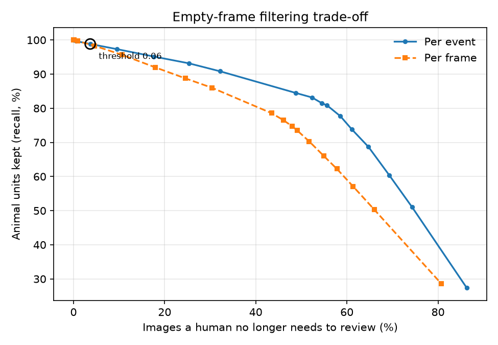
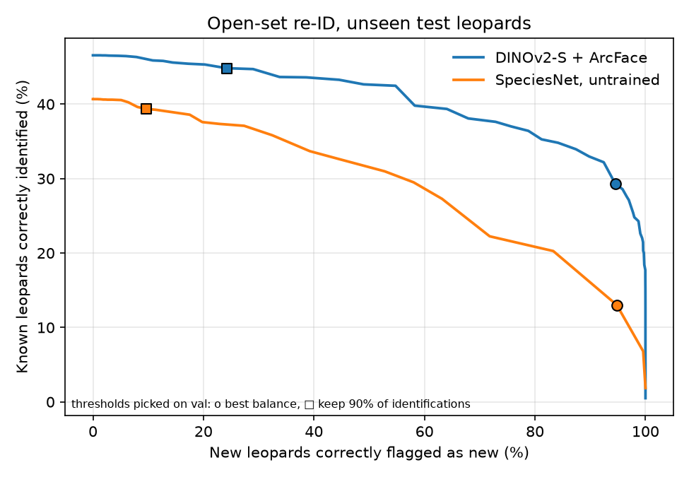

# Ghats Wildlife AI

Camera-trap intelligence for the Western Ghats: find the animals in thousands of
trigger images, identify the species, recognise individual leopards, search the
archive in plain English, and run it all on a low-power device in the forest.

Forest departments and researchers in Goa (Mhadei, Bhagwan Mahavir, Cotigao,
Netravali) collect far more camera-trap images than anyone can review by hand,
and most frames are empty, triggered by wind, sun or moving leaves. This project
builds the pipeline that does the first pass automatically and sends people only
what needs a human decision.

## Roadmap

| Phase | What | Status |
|---|---|---|
| 1 | Animal detection and empty-frame filtering (MegaDetector V6) | **Done** (results below) |
| 2 | Species classification for Ghats groups, location-split evaluation, SpeciesNet baseline | **Done** (results below) |
| 3 | Leopard re-identification (metric learning + travel-feasibility prior) | **Done**, except the travel prior (no location data) |
| 4 | Natural-language search over detections (BioCLIP/CLIP + vector DB) | Planned |
| 5 | Reviewer dashboard with an active-learning loop | Planned |
| 6 | Edge deployment: ONNX/INT8 on Raspberry Pi 5 or Jetson, cascade design, benchmarks | Planned |

## Phase 1: detection and empty-frame filtering

**Question:** at what confidence threshold can MegaDetector remove most empty
frames while keeping (almost) every animal, on tropical Asian forest data it was
mostly not trained on?

**Data:** a balanced sample from [SWG Camera Traps 2018–2020](https://lila.science/datasets/swg-camera-traps)
(Vietnam and Laos, via LILA BC). It is the closest public stand-in for Western
Ghats conditions: dense forest, IR night images, and many of the same genera.
Species are mapped to Ghats groups in [`configs/phase1.yaml`](configs/phase1.yaml)
(e.g. red muntjac → barking deer, chevrotain → mouse deer).

### Run it

```bash
python -m venv .venv && source .venv/bin/activate      # Windows: .venv\Scripts\activate
pip install -r requirements.txt && pip install -e .

# 1. Metadata + ~1,200 sequences (~5,500 images, a few GB). Resumable.
python scripts/01_fetch_subset.py

# 2. Detector. Try --limit 50 first. CPU works; a GPU (or free Colab T4) is much faster.
python scripts/02_run_detector.py

# 3. Metrics, trade-off plot and summary
python scripts/03_evaluate.py

# 4. Picture grids of misses and false alarms (use the threshold from summary.md)
python scripts/04_gallery.py --threshold 0.01

# 5. Filter rules on top of the detector vs. the plain max score (uses saved detections)
python scripts/05_filter_experiments.py

pytest   # unit + end-to-end tests, no network or GPU needed
```

The metadata file is large, and parsing it needs a few GB of RAM. Fetching is a
one-time cost; everything after works offline.

### Results

5,726 frames in 1,200 trigger events (600 animal, 600 empty) from 507 camera
locations. Full numbers in [`reports/phase1/summary.md`](reports/phase1/summary.md).

| Threshold (per trigger event) | Animal events kept | Empty events removed | Review workload removed |
|---|---|---|---|
| 0.01 (the lowest stored) | 96.5% (21 of 600 missed) | 28.0% | 15.8% |
| 0.02 | 94.8% | 40.0% | 22.6% |
| 0.06 | 90.2% | 65.0% | 37.4% |

Worst species group at 0.01: pangolin 87.8%, then rodent 92.7% and macaque 92.9%.
Latency per image (GPU, RTX 3050 Laptop, batches of 16): 28 ms median, 40 ms p95,
including JPEG decode.



**The short version: out of the box, MegaDetector doesn't filter this forest well.**
The 98% recall target can't be reached at all. 21 animal events have no box above 0.01,
and keeping 95% of animals still leaves 72% of empty events for a person to review.
Things get better if you accept 90% recall, where it removes 65% of empty events.

**Why.** Looking at the highest-scoring "empty" events
([`false_alarms.jpg`](reports/phase1/false_alarms.jpg)) shows the same few culprits over
and over: big leaves right in front of the lens (scoring up to 0.88), dark rocks
and shadows, sun glare, and tree trunks cut off at the frame edge. Dense tropical
undergrowth is full of animal-sized, animal-shaped clutter.

Some of the errors are the labels, not the model. A couple of "empty" events contain
a person's legs or what looks like an animal at night. The missed animal events
([`missed_animals.jpg`](reports/phase1/missed_animals.jpg)) are a mix. At
thumbnail size most look empty, but the pangolin bursts I checked at full size do
have the animal in them: a dim shape the same colour as the leaf litter under IR.
Pangolin is the worst group (5 of the 21 misses).

### What I tried on top of the detector

If leaves cause the false alarms, two cheap rules should help, without any retraining.
Both are in [`src/ghats/filters.py`](src/ghats/filters.py) and compared in
[`reports/phase1/filter_experiments.md`](reports/phase1/filter_experiments.md).

| Rule (at the lowest threshold, 0.01) | Animal events kept | Empty events removed |
|---|---|---|
| Max score (baseline) | 96.5% | 28.0% |
| Burst agreement: 2 frames must see an animal | 94.0% | 35.2% |
| Burst agreement: the same box in 2 frames | 84.7% | 37.8% |
| Camera background: drop boxes where this camera fired in other events (IoU 0.5) | 95.0% | 29.3% |

Neither is better than just raising the threshold: at 94% recall the plain max score
already removes about 40% of empty events, more than burst agreement's 35%. Burst agreement
fails for three reasons: 26% of events are a single frame, animals often show up in
only one frame of a burst, and leaves don't move, so they "agree" with themselves.
Camera background could work on a real deployment, but this sample deliberately
spreads across 507 cameras with a median of 2 events each, which isn't enough
history to learn what a camera's background looks like.

**What this means for Phase 2.** No rule on the detector's score will separate leaves
from animals here, because the scores overlap. The fix has to look at the crop itself.
Phase 2 trains a classifier on detector crops anyway, so it gets an extra
"vegetation / no animal" class trained on these exact false alarms.

### Design decisions

- **Sampling and evaluation by trigger event, not frame.** A camera fires a burst
  of frames per trigger, and LILA often labels the whole sequence. A frame where
  the animal has already left still says "wild pig", so frame-level misses are
  partly label noise. Event-level numbers are the honest headline.
- **Per-camera caps.** No camera contributes more than a few sequences, so the
  result reflects many backgrounds rather than one busy waterhole.
- **Thresholds are swept, not guessed.** The detector stores everything above
  0.01; the operating point is the highest threshold that keeps 98% of animal
  events, or the lowest threshold when even that falls short (as it does here).
- **Per-group recall.** Small and nocturnal animals are where detectors usually
  fail, so recall is reported per species group. Here the weakest was pangolin
  (87.8%), then rodent and macaque.
- **Boxes on the letterbox padding are dropped.** SWG frames are wider than they
  are tall, so the 640×640 input is padded above and below. The model puts low-
  confidence boxes (up to ~0.2) on that padding in almost every image; after
  mapping back they sit wholly outside the frame and clamp to zero-height lines
  on the border. I first missed this, and it quietly ruined the numbers: their
  confidence is noise (event AUC 0.53), but it gave every event, empty or not, a
  score of ~0.08. The old "98.8% recall at 0.06" came from that, not from real
  boxes. I found it while looking at Phase 2 misses (`scripts/10_miss_gallery.py`).
- **The detector runs in eval mode, in batches.** PyTorch-Wildlife 1.3's
  `single_image_detection()` for the MIT model reloads the checkpoint on every call
  and leaves the network in training mode, so BatchNorm normalises each image with
  its own statistics instead of the learned ones. `src/ghats/detector.py` loads the
  model once, calls `eval()`, and runs batches fed by a multi-process DataLoader.
  On the Phase 1 set this raised event-level AUC from 0.870 to 0.903 (both measured
  before the padding fix below; 0.913 after it) and cut
  latency from 826 ms to 28 ms per image (median).
- **MIT-licensed detector by default.** `MegaDetectorV6MIT` avoids the AGPL terms
  of the Ultralytics-based weights; the config can switch models for comparison.

## Phase 2: species classifier on detector crops

**Question:** can a classifier that looks at each detector crop name the species, and
also catch the leaves and rocks that fool the detector?

```bash
python scripts/06_make_crops.py          # detector boxes -> labelled crops, split by camera
python scripts/07_train_classifier.py    # ConvNeXt-Tiny, ~75 s/epoch on an RTX 3050 Laptop
python scripts/09_event_eval.py          # empty-event filtering: detector vs classifier
python scripts/10_miss_gallery.py --threshold 0.504   # animal events the filter throws away
python scripts/11_speciesnet_probe.py    # frozen SpeciesNet features + logistic regression head
```

**Crops and labels.** Every animal box at 0.02 or above becomes a crop (up to 5 per frame).
Boxes in empty events are labelled "background". Boxes in animal events take the event's
species group, but only boxes at 0.2 or above are used for training, since a weak box
next to an animal is often a leaf.

**Split by camera, not by image.** Whole camera locations go to train, val or test
(70/15/15). Frames from one camera share a background, so a random split would let the
model recognise the place instead of the animal. Test is 106 cameras the model never saw.

**Model.** ConvNeXt-Tiny (ImageNet-22k weights, via timm), 12 epochs, mixed precision,
square-root class weights for the imbalance, label smoothing 0.1, best epoch picked
on val macro F1.

### Results

**Crops** (test, 2,383 crops): macro F1 **0.776**, accuracy 0.833. Best: junglefowl 0.93,
wild boar 0.91, bear 0.90. Worst: squirrel 0.46 and mongoose 0.49, small classes with
20–50 test crops each. Background F1 is 0.84. Details in
[`classifier_summary.md`](reports/phase2/classifier_summary.md).

**Empty-event filtering** (test, 566 events from unseen cameras; each threshold is picked
on val and applied unchanged to test):

| Keep 90% of animal events | Empty events removed |
|---|---|
| Detector confidence (Phase 1 rule) | 54.7% |
| Classifier: P(not background) of the best box | **69.3%** |
| Classifier × detector | 60.0% |

The classifier removes about 15 points more empty events at the same recall. Stricter
targets are out of reach for every method: 25 of 416 animal test events (6%) have no
detector box at all, so nothing downstream can recover them. Full table, including
per-group recall, in [`event_eval.md`](reports/phase2/event_eval.md).

**Where it still fails** ([`missed_events.jpg`](reports/phase2/missed_events.jpg)).
At the 90% threshold, 83 val/test animal events are dropped. 53 of them never had a box
(a detector miss), and 30 had boxes the classifier called background. The detector is
the bigger bottleneck, and it is worst on small animals: rodents, squirrels and martens.

### Against off-the-shelf classifiers

`scripts/08_run_baselines.py` runs two existing camera-trap classifiers on the same
val/test boxes and maps their labels onto my groups:
[SpeciesNet](https://github.com/google/cameratrapai) v4.0.2a (Google, ~2,500 labels,
65M+ training images) and the Addax Data Science Central India model (IND-ADS, 40 labels,
CC-BY-NC, used for evaluation only).

| Model | Macro F1, 12 shared classes (2,139 test crops) | Empty events removed at 90% recall |
|---|---|---|
| Mine (ConvNeXt-Tiny, ~10k crops) | 0.812 | 69.3% |
| SpeciesNet | **0.903** | **76.7%** |
| IND-ADS (Central India) | 0.641 | 63.3% |

**SpeciesNet wins, with a caveat.** Its training data includes public camera-trap
repositories, and I couldn't confirm whether SWG was among them. If it was, it has seen
these exact cameras, and the comparison flatters it. Even so, the gap is largest exactly
where my model has the least data: mongoose 0.94 vs 0.51, sambar 0.99 vs 0.77. Mine is
ahead only on small cats (0.70 vs 0.63) and bears (0.90 vs 0.88). The Central India model
is the more honest out-of-domain test: trained on Indian forest, it is weaker than mine
on Vietnamese and Lao cameras (0.64), especially on macaques (0.36) and small cats (0.25).

### Building on SpeciesNet instead

Is SpeciesNet's edge its backbone (features learned from 65M camera-trap images) or its
head (which may have seen SWG)? `scripts/11_speciesnet_probe.py` keeps the backbone frozen,
takes its pooled 1,280-d features for every crop, and fits a logistic regression on my
train cameras only. This is the same recipe the Central India model uses, just trained
on my groups and cameras. It takes ~15 minutes on the 3050, mostly feature extraction.

| Model | Macro F1, all 16 classes (2,383 test crops) | Macro F1, 12 shared classes | Empty events removed at 90% recall |
|---|---|---|---|
| Mine (ConvNeXt-Tiny, trained end to end) | 0.776 | 0.812 | 69.3% |
| **SpeciesNet features + my head** | **0.887** | **0.920** | 74.0% |
| SpeciesNet off the shelf | n/a | 0.903 | 76.7% |

The probe is the best species classifier here, ahead even of SpeciesNet's own head on
the shared classes. The biggest gains over my ConvNeXt are on the classes I had the least
data for: mongoose 0.49 → 0.91, squirrel 0.46 → 0.65, sambar 0.77 → 0.94. For filtering
empty events it is level with SpeciesNet (74.0% vs 76.7% is within the ±6 point noise of
150 empty test events). Details in
[`classifier_summary_probe.md`](reports/phase2/classifier_summary_probe.md).

The SWG caveat still applies: if SpeciesNet's backbone was trained on these cameras, the
probe benefits too. Only data from cameras SpeciesNet has never seen, ideally from the
Ghats, would settle that.

What I take from it: with ~10k labelled crops, a strong pretrained camera-trap backbone
plus a small head beats training a model end to end, and costs a fraction of the compute.
That's the setup I'd carry forward. The parts of the project I'd call my own are the
evaluation (event-level, unseen cameras, thresholds picked on val) and finding the
padding bug.

**Things I tried that didn't help** (on the earlier run, before the padding fix):
requiring a second convincing box per event (22% of animal events have only one),
temperature scaling (better calibrated probabilities, same ranking, so the same
filtering), and turning off label smoothing (slightly higher F1, filtering within noise:
150 empty test events give about ±6 points).

## Phase 3: leopard re-identification

**Question:** given a photo of a leopard, can the system find other photos of the same
individual from its spot pattern? That is how survey teams count leopards and track
them across cameras.

**Data:** [Leopard ID 2022](https://lila.science/datasets/leopard-id-2022/) (Wild Me and
Botswana Predator Conservation Trust, via LILA BC): 6,795 photos of 430 named African
leopards, with boxes and a viewpoint label per animal. They're not Indian leopards, but
it's the same species and the same spot-matching problem. I keep only left and right flank
views (4,502 crops), because front and back views show different spots.

```bash
python scripts/12_leopard_crops.py   # crops + split by individual (needs the 8 GB download, see configs/phase3.yaml)
python scripts/13_reid_baseline.py   # off-the-shelf embeddings, retrieval metrics
```

**How it's evaluated** ([`src/ghats/reid.py`](src/ghats/reid.py)):

- **Split by individual.** Test leopards (107 of them, 1,361 crops) are never used for
  training or tuning. Same idea as splitting by camera in Phase 2.
- **No same-encounter matches.** Photos from one sighting are near-duplicates, so matching
  them says nothing about recognising the leopard weeks later; they're removed from the
  ranking. The dataset has no timestamps, so an encounter is a run of consecutive image ids
  showing the same leopard. That's a proxy, so I also report how many correct matches come
  from images within 10 ids of the query (16% here).
- **Same flank only.** A left-side photo can only be matched by another left-side photo.
- **Averaged per leopard.** A few leopards were photographed 100+ times. Averaged per query,
  they dominate: SpeciesNet's top-1 is 62.5% per query but 36.7% per leopard. Like macro F1
  in Phase 2, the per-leopard number is the headline.

### Baseline: off-the-shelf features, no training

Every crop is embedded, then each test crop is a query against all the other test crops.

| Model | Top-1 | Top-5 | mAP | Val top-1 |
|---|---|---|---|---|
| DINOv2 ViT-B/14 (general-purpose) | 26.7% | 37.3% | 22.2% | 30.0% |
| DINOv2 ViT-S/14 | 29.6% | 38.4% | 22.7% | 28.9% |
| SpeciesNet backbone (camera-trap species classifier) | 36.7% | 47.0% | 25.9% | 27.9% |

None of these models was trained to tell individuals apart, and it shows: the right leopard
comes first about a third of the time. SpeciesNet leads on test but not on val, so with ~100
leopards per split there is no clear winner yet. Full numbers in
[`reid_baseline.md`](reports/phase3/reid_baseline.md).

### Fine-tuned with ArcFace

```bash
python scripts/14_train_reid.py      # DINOv2-S + ArcFace on the train leopards, ~65 s/epoch on an RTX 3050
```

ArcFace trains the embedding so photos of one leopard sit close together and other
leopards are pushed a fixed angle away. Choices that matter here:

- **A class is one leopard's flank**, not one leopard (355 flanks from 209 leopards).
  The left and right sides have different spots, so they shouldn't be pulled together.
- **No horizontal flips.** The usual augmentation would turn a left flank into a right
  flank that doesn't exist. Instead: random crops, colour jitter, and random grayscale,
  since night photos are infrared.
- **DINOv2-S, fully fine-tuned**, input 224×448 (flank crops are wide), 20 epochs, the
  best epoch picked on val leopards.

| Test, 107 unseen leopards | Top-1 | Top-5 | Top-10 | mAP |
|---|---|---|---|---|
| DINOv2-S, untrained (same input size) | 28.4% | 39.7% | 44.3% | 22.8% |
| SpeciesNet backbone, untrained (best baseline) | 36.7% | 47.0% | 50.4% | 25.9% |
| **DINOv2-S + ArcFace** | **40.2%** | **57.1%** | **64.5%** | **35.4%** |

Fine-tuning lifts every metric. The clearest gain is in the shortlist: the right leopard is
in the top 5 for 57% of leopards, up from 40%. Top-1 beats the best baseline by only 3.5
points, which is within the noise of ~100 test leopards (about ±5 points); top-5 and mAP
gain 10 points each, which is not. The training loss reached almost zero by epoch 10 while
val top-1 stayed at 35–39%, so with 2,450 training photos the model memorises the training
leopards faster than it learns general spot matching. More leopards would help more than
more epochs. Details in [`reid_finetune.md`](reports/phase3/reid_finetune.md).

In practice that makes this a ranking tool, not an automatic identifier: show a reviewer
the top 5 or 10 candidates and let them confirm, which is the Phase 5 dashboard.

### Recognising new leopards (open set)

```bash
python scripts/15_open_set.py        # "new individual" threshold, simulated on unseen leopards
```

Plain retrieval always returns the closest leopard, even for an animal that's not in the
catalogue. Real surveys meet new leopards all the time, so the system needs to be able to
answer "new": if the best match is less similar than a threshold, call it new.

To test that, I hide a random half of the test leopards from the gallery, so their photos
should come back "new", and repeat it over 20 random draws. The threshold is picked on val
leopards and applied unchanged to test.



| Test, 107 unseen leopards | Known leopards identified | New leopards flagged |
|---|---|---|
| ArcFace, no "new" option | 46.6% | 0% |
| ArcFace, strict threshold (keep 90% of identifications on val) | 44.8% | 24.2% |
| ArcFace, best-balance threshold | 29.3% | 94.5% |
| SpeciesNet untrained, best-balance threshold | 13.0% | 94.8% |

The fine-tuned model is better along the whole curve: AUROC 0.778 for telling known from
new leopards by similarity, against 0.700 for the untrained baseline. The threshold is the
weak point. The strict rule was tuned on val to keep 90% of identifications. On test it
kept 96% and flagged only 24% of new leopards, while the test curve shows about 55% was
possible at a similar cost. Similarity levels shift between groups of leopards, so a
threshold tuned on one population doesn't transfer exactly. A deployment in the Ghats
would need to recalibrate on its own labelled photos, and in a reviewer-in-the-loop setup
that calibration comes for free as reviewers confirm or reject matches.

**Not done: the travel-feasibility prior.** The plan was to rule out matches that would
need a leopard to cross a reserve faster than leopards travel, using camera locations and
times. Leopard ID 2022 has neither (no timestamps, GPS or EXIF), so this needs a dataset
with camera metadata, or Ghats data from the outreach requests.

## Repository layout

```
configs/phase1.yaml        dataset, sampling, detector, evaluation settings
configs/phase2.yaml        bigger sample for classification, crop and split settings
configs/phase3.yaml        leopard dataset, crops, split by individual, re-ID models
src/ghats/                 coco_ct (metadata), events, metrics, filters, crops, detector wrapper, baselines, reid, reid_model
scripts/01..05             fetch -> detect -> evaluate -> gallery -> filter experiments
scripts/06..11             crops -> classifier -> baselines -> event eval -> miss gallery -> speciesnet probe
scripts/12..15             leopard crops -> re-ID baseline -> ArcFace fine-tune -> open set (Phase 3)
tests/                     unit tests + synthetic end-to-end pipeline test
reports/phase1, phase2/    generated results (committed)
```

## Data and models

- SWG Camera Traps 2018–2020, CDLA-Permissive-1.0. Citation: SWG (2021),
  *Northern and Central Annamites Camera Traps 2.0*, IUCN SSC Asian Wild Cattle
  Specialist Group's Saola Working Group.
- MegaDetector V6 via [PyTorch-Wildlife](https://github.com/microsoft/CameraTraps).
- Leopard ID 2022, CDLA-Permissive-1.0, Wild Me and Botswana Predator Conservation Trust, via LILA BC.
- DINOv2 (Meta) via timm; SpeciesNet (Google) weights from Addax Data Science.
