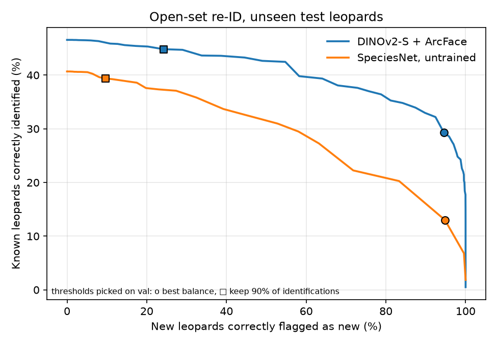

# Phase 3: recognising new leopards (open-set re-ID)

Test: 107 unseen leopards. In each of 20 draws a random half is removed from the gallery, so their photos should be answered "new"; photos of leopards seen in only one encounter count as new too. A photo is answered "new" when its best match is below a threshold picked on val and applied unchanged to test. Rates are averaged per leopard, then over draws.

Two ways to pick the threshold: the best balance of the two rates, or the strictest threshold that still keeps 90% of the correct identifications you'd get with no "new" option.

| Model | Threshold rule | Threshold | Known identified | New flagged |
|---|---|---|---|---|
| DINOv2-S + ArcFace | best balance | 0.60 | 29.3% | 94.5% |
| DINOv2-S + ArcFace | keep 90% of identifications | 0.42 | 44.8% | 24.2% |
| SpeciesNet, untrained | best balance | 0.97 | 13.0% | 94.8% |
| SpeciesNet, untrained | keep 90% of identifications | 0.82 | 39.4% | 9.6% |

| Model | Known identified, no "new" option | AUROC known vs new |
|---|---|---|
| DINOv2-S + ArcFace | 46.6% | 0.778 |
| SpeciesNet, untrained | 40.7% | 0.700 |

